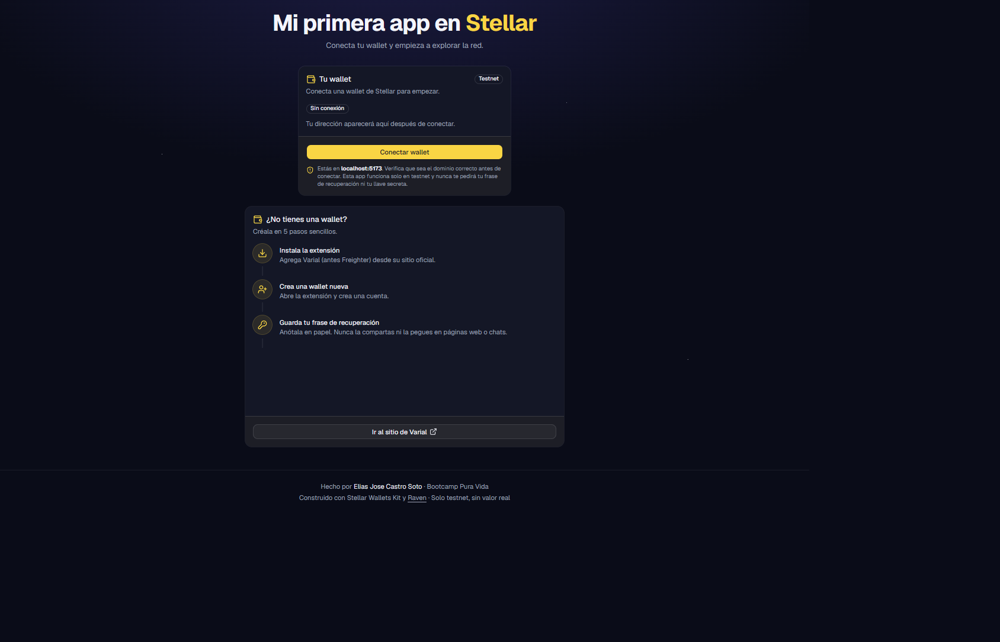
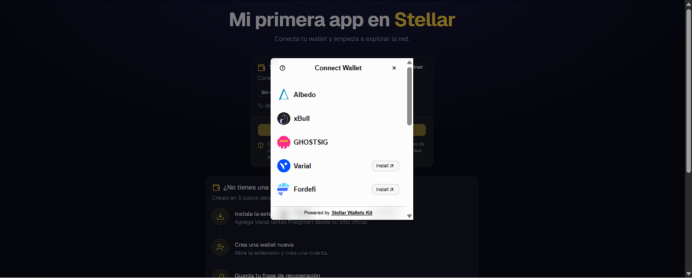
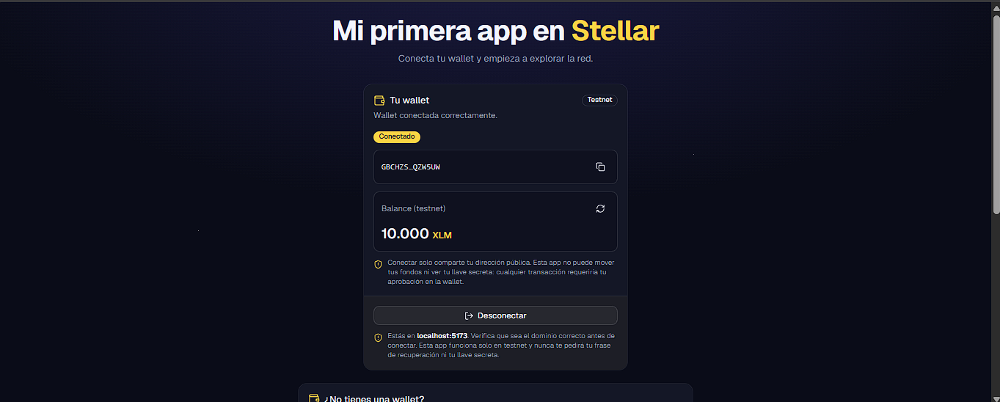
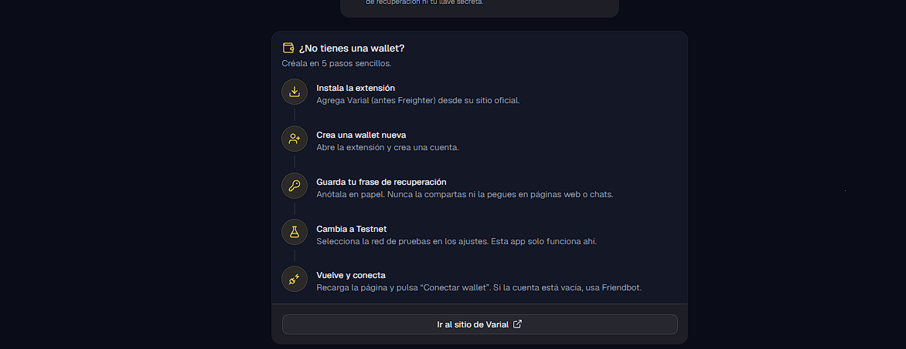
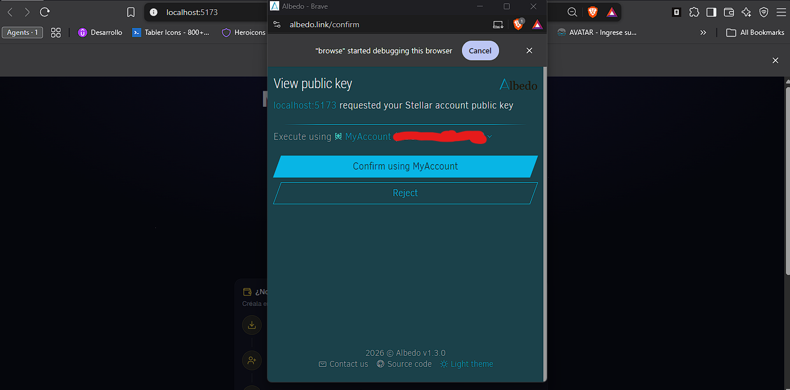
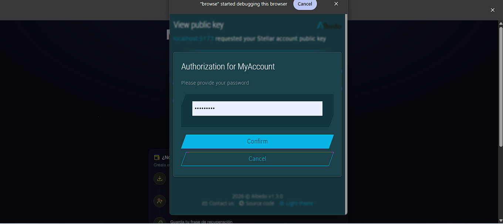
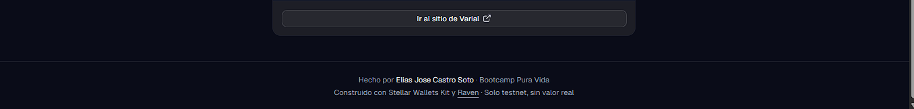

# Mi primera app en Stellar

**Autor:** Elias Jose Castro Soto
**Reto:** Bootcamp Pura Vida · Tu primera app en Stellar con Stellar Raven

Aplicación web básica sobre la red Stellar (testnet). Permite conectar una wallet
de Stellar, ver la dirección y el balance de XLM, y fondear cuentas nuevas con
Friendbot. Fue construida usando **Stellar Raven**, el servidor MCP oficial de
Stellar, como asistente de desarrollo.



## Qué hace

- **Conectar wallet** con Stellar Wallets Kit v2 (selector multi-wallet, red testnet).
- Muestra la **dirección abreviada**, botón de copiar, estado "Conectado" y "Desconectar".
- Consulta el **balance de XLM** en testnet (Horizon) y permite actualizarlo.
- Si la cuenta **no existe aún en testnet**, ofrece fondearla con **Friendbot** (XLM de prueba).
- Sección **"¿No tienes una wallet?"** con 5 pasos ilustrados y animados para crear una.
- **Avisos de seguridad** contra phishing y sobre el alcance de la conexión.
- Tema oscuro responsive, con fondo estelar.

**Flujo completo:**

Selector de wallets al conectar:



Wallet conectada con dirección y balance:



Guía para quienes aún no tienen wallet:



## Stack

| Tecnología | Uso |
|---|---|
| Vite 8 | Servidor de desarrollo y build |
| React 19 (JavaScript + JSX) | Interfaz |
| Tailwind CSS v4 (`@tailwindcss/vite`) | Estilos |
| shadcn/ui (Radix, preset Nova) + Lucide | Componentes e iconos |
| Stellar Wallets Kit v2 (`@creit-tech/stellar-wallets-kit`, vía JSR) | Conexión de wallets |
| Horizon testnet / Friendbot | Balance y fondeo |
| oxlint | Linter |

## Requisitos

- **Node.js 22 o superior** (desarrollado con Node 24 y npm 11).
- Una wallet de Stellar en el navegador configurada en **Testnet**
  (ver [Cómo conectar](#cómo-conectar-en-testnet)).

## Cómo correrla

```bash
git clone https://github.com/<tu-usuario>/Pura-Vida-Bootcamp-1.git
cd Pura-Vida-Bootcamp-1
git checkout feature/Elias-Castro-Soto
cd "Elias Jose Castro Soto"

npm install
npm run dev
```

Abre `http://localhost:5173`. Otros comandos:

```bash
npm run build     # build de producción
npm run preview   # sirve el build localmente
npm run lint      # oxlint
```

El proyecto incluye un `.npmrc` para el registro de JSR, de donde viene el Wallets Kit,
así que `npm install` / `npm ci` funcionan sin pasos extra.

## Cómo conectar en Testnet

1. Instala una wallet de navegador: **Varial** (antes Freighter) o usa **Albedo**
   (wallet web). La app incluye una guía paso a paso para esto.
2. Crea una cuenta **nueva y desechable**, solo para pruebas.
3. Cambia la red de la wallet a **Testnet**.
4. En la app, pulsa **Conectar wallet** y elige tu wallet en el selector.
5. Si el balance dice que la cuenta no existe, pulsa **Fondear con Friendbot**
   para recibir XLM de prueba.



Albedo pide la contraseña para autorizar el acceso a la clave pública:



**Probado con:** **Albedo** (wallet web, testnet).

## Estructura del proyecto

```
Elias Jose Castro Soto/
├── index.html
├── vite.config.js            # plugins + alias (@ y fix del Kit, ver Decisiones)
├── jsconfig.json
├── components.json           # configuración de shadcn/ui
├── .npmrc                    # registro de JSR
├── package.json
└── src/
    ├── main.jsx
    ├── App.jsx               # pantalla principal (Card de conexión)
    ├── index.css             # tema oscuro y fondo estelar
    ├── components/
    │   ├── NoWalletGuide.jsx # guía de 5 pasos para crear una wallet
    │   ├── SecurityNote.jsx  # aviso de seguridad reutilizable
    │   ├── Footer.jsx
    │   └── ui/               # button, card, badge (shadcn)
    ├── hooks/
    │   ├── useStellarWallet.js  # conexión con el Kit (authModal / disconnect)
    │   ├── useXlmBalance.js     # balance y fondeo
    │   └── useInView.js         # animación de entrada (IntersectionObserver)
    └── lib/
        ├── stellar.js        # llamadas a Horizon y Friendbot
        └── utils.js
```

## Cómo usé Raven

Conecté **Raven** (`https://raven.stellar.org/mcp`) como conector MCP en **Claude** y
en **OpenCode**. Lo usé a lo largo del desarrollo para consultar la documentación oficial
de Stellar antes de escribir código. Estas fueron las consultas y lo que decidí gracias a ellas.

### 1. ¿Qué es una wallet, qué es Freighter y cómo conectarlo con Stellar Wallets Kit?

- **Prompt:** *"Usa Raven para explicarme qué es una wallet, qué es Freighter y cómo
  conectar Freighter con Stellar Wallets Kit."*
- **Qué respondió Raven:**
  - Una wallet no guarda monedas, guarda **llaves**. La cuenta vive en la red y se
    identifica por su llave pública (`G...`); la secreta firma las transacciones.
  - En la documentación oficial, **Freighter aparece ahora como Varial**
    (antes Freighter).
  - El Kit **v2** se instala desde **JSR** (no npm), requiere Node 22+, es un
    *singleton* que se inicia una vez (`StellarWalletsKit.init`) y conecta con
    `authModal()`. La API de la v1 ya no aplica.
- **Qué decidí:**
  - Usar Kit v2 con `authModal()` en un hook propio (`useStellarWallet`) y red testnet.
  - Instalarlo con `npx jsr add` y descartar tutoriales de la v1.
  - Mencionar ambos nombres (Varial/Freighter) en la guía para el usuario.
  - Diseñar la app para que **nunca toque llaves secretas**: solo recibe la dirección pública.

### 2. Estilo visual de Stellar

- **Prompt:** *"Usa Raven para consultar el estilo visual de Stellar."*
- **Qué respondió Raven:** no entregó una paleta oficial. Sí aportó principios
  de la marca (cercana, con color e ilustración), la existencia de un *Brand Resource Hub*
  y que el nombre y diseño de Stellar son **marcas registradas**.
- **Qué decidí:** crear un **tema propio** (oscuro, fondo estelar, acento amarillo)
  *inspirado* en esa identidad, sin copiar colores oficiales y **sin usar el logo de Stellar**.

### 3. Balance, Friendbot y manejo de errores

- **Prompt:** *"Usa Raven para ver cómo mostrar el balance en testnet, fondear con Friendbot
  y qué hacer si el usuario no tiene wallet."*
- **Qué respondió Raven:**
  - Friendbot entrega **10,000 XLM de prueba** al fondear una cuenta nueva y tiene
    límite de uso.
  - El playbook consulta el balance en **Horizon testnet**; existe una guía oficial
    para migrar de Horizon a RPC.
  - Checklist de errores a manejar: wallet no conectada, usuario rechaza, cuenta sin fondos, red equivocada.
- **Qué decidí:**
  - Consultar `horizon-testnet.stellar.org/accounts/{dirección}`; un **404** significa
    "cuenta sin fondear" y activa el botón de Friendbot.
  - Mostrar mensajes de error claros en español (modal cerrado, Friendbot limitado, red caída).
  - Agregar la sección **"¿No tienes una wallet?"** para quien no tenga una.

### 4. Estructura del README

- **Prompt:** *"Usa Raven para ver si se utiliza una estructura específica para el README."*
- **Qué respondió Raven:** no encontró ninguna plantilla obligatoria para este reto;
  solo prácticas generales (requisitos, instalación, configuración y ejecución).
- **Qué decidí:** usar la estructura de este documento y poner la evidencia de Raven
  en una sección propia.

### 5. Seguridad de apps que se conectan a wallets

- **Prompt:** *"Usa Raven para buscar políticas de seguridad para la wallet o una app que
  se conecte a la wallet."*
- **Qué respondió Raven:** la guía oficial **"Securing Web-Based Projects"**: TLS/HTTPS,
  cabeceras CSP y HSTS, no almacenar datos sensibles, advertir sobre phishing
  (incluyendo pedir al usuario que verifique el dominio) y escanear librerías.
- **Qué decidí:**
  - Crear el componente `SecurityNote` con **tres avisos**: dominio actual y "nunca te pedirá
    tu frase de recuperación", alcance de la conexión (solo dirección pública) y
    Friendbot sin valor real.
  - No guardar llaves ni datos sensibles; usar solo URLs HTTPS.
  - Correr `npm audit` y documentar el resultado (ver [Seguridad](#seguridad)).

### 6. Evidencia

> 📸 **Evidencia:** [Consulta sobre estructura del README con Raven en Claude](./docs/raven-claude.png)

## Decisiones técnicas

- **Alias del Kit en `vite.config.js`.** La dependencia `@metamask/connect-stellar`
  importa `"@creit.tech/stellar-wallets-kit"` (scope con punto), pero solo lo declara como
  `devDependency`, y el paquete que instalamos desde JSR se llama
  `@creit-tech/stellar-wallets-kit`. Sin remapearlo, `npm run build` falla. El alias
  apunta ese import al paquete de JSR ya instalado.
- **Hooks propios** (`useStellarWallet`, `useXlmBalance`, `useInView`) para separar la lógica
  de la interfaz.
- **Sin librerías de animación:** la entrada de los pasos usa `IntersectionObserver` y
  respeta `prefers-reduced-motion`.
- **Un commit por funcionalidad**, compilando en cada paso.

## Seguridad

- La app **no maneja llaves secretas ni frases de recuperación**: las custodia la wallet.
- Conectar solo comparte la **dirección pública**; la app no puede mover fondos.
- Funciona **solo en testnet**; se recomienda usar una cuenta desechable.
- Todas las URLs externas usan HTTPS.
- Se muestran avisos de phishing y de verificación de dominio.
- **`npm audit`** reporta **50 vulnerabilidades transitivas** provenientes del Kit y sus
  dependencias. Al ser una app de demostración en testnet, sin backend ni datos de usuario,
  el riesgo práctico es bajo, pero se dejan documentadas.

## Limitaciones conocidas

- Solo testnet: no está preparada para mainnet.
- El balance usa Horizon, que Stellar recomienda migrar a RPC a futuro.
- Friendbot tiene límite de uso y puede rechazar peticiones.
- La app no firma transacciones ni envía pagos todavía.
- Depende de una wallet externa instalada (o Albedo, que funciona vía web).
- Los pasos de la guía de Varial están redactados de forma general; los nombres exactos
  de menús pueden variar.

## Créditos

Construido con [Stellar Wallets Kit](https://jsr.io/@creit-tech/stellar-wallets-kit),
[shadcn/ui](https://ui.shadcn.com), [Lucide](https://lucide.dev) y asistido por
[Stellar Raven](https://raven.stellar.org).
Desarrollado por Elias Jose Castro Soto para el Bootcamp Pura Vida.


