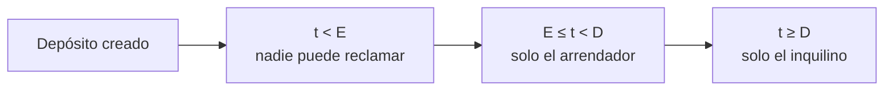

<p align="center">
  
</p>

<h1 align="center">Plazo</h1>

<p align="center">Un depósito de garantía que nadie custodia. El plazo es el juez.</p>

> **[Nombre completo del participante]** · Entregable 1 del Pura Vida Bootcamp (Stellar).
> Práctica en **testnet**, con dinero de prueba y sin validez legal.

## Qué es

En un depósito de garantía (casa, carro, equipo) el dinero queda en manos del arrendador, y si nadie hace nada, sigue ahí. Plazo invierte ese default: el depósito se bloquea en la red Stellar con reglas de tiempo, y si el arrendador no actúa a tiempo, el inquilino puede recuperarlo sin pedir permiso a nadie.

Se apoya en los *claimable balances* de Stellar: la red, no una persona, decide quién puede retirar el dinero en cada momento.

## Cómo funciona

`E` es el fin del contrato y `D` el plazo límite de reclamo, con `E < D`.



Si el arrendador no hace nada entre `E` y `D`, el inquilino recupera el depósito después de `D`. Para cobrar, el inquilino firma una transacción de reclamo y paga una comisión mínima.

## Funcionalidades

- Conectar la wallet Varial en testnet y ver dirección y saldo.
- Crear un depósito indicando arrendador, monto, `E` y `D`.
- Ver los depósitos de la cuenta conectada, con su rol y estado.
- Reclamar cuando las reglas de tiempo lo permiten.
- **Modo demo:** `E` y `D` en minutos para probar el flujo completo.

> **Estado:** en desarrollo. Hoy el proyecto tiene la base (Vite, React, Tailwind, Vitest y los SDK); las funcionalidades se agregan por fases.

## Límites

- No hay árbitro: la cadena decide quién puede actuar y cuándo, no si hubo daño.
- En la v1, el arrendador puede llevarse el 100 % del depósito dentro de su ventana.
- El tiempo lo da la red (hora de cierre del ledger), así que cerca de `E` o `D` puede haber diferencias de segundos.
- XLM cambia de precio; algo real usaría una stablecoin.
- Ambas partes necesitan una wallet y algo de XLM para comisiones.
- Es una práctica: no sustituye ningún contrato.

## Tecnologías

React, React Router, TypeScript, Vite, Tailwind CSS, Vitest, `@stellar/stellar-sdk` y `@stellar/varial-sdk`.

## Cómo ejecutarlo

Requiere [Bun](https://bun.sh) y la extensión de [Varial](https://developers.stellar.org/docs/tools/developer-tools/wallets) en el navegador, configurada en testnet.

```sh
bun install
bun run dev      # servidor local
bun run test     # tests de entity
bun run build    # compilación de producción
```

Para probar el flujo completo se necesitan **dos cuentas de testnet** (inquilino y arrendador), distintas entre sí, fondeadas con [Friendbot](https://friendbot.stellar.org). Con el modo demo, crea un depósito con `E` en +2 min y `D` en +5 min y comprueba:

1. Antes de `E` nadie puede reclamar.
2. Entre `E` y `D` reclama el arrendador.
3. Con otro depósito, si nadie reclama, el inquilino recupera el dinero después de `D`.

## Cómo usé Stellar Raven

_Pendiente: se completa al cerrar la entrega con lo que consulté, lo que verifiqué (nombres del SDK, estado de Horizon, imports de Varial) y lo que corrigió._

## Documentación

- [`context/approach.md`](context/approach.md): la idea y el alcance.
- [`context/structure.md`](context/structure.md): arquitectura y flujos.
- [`context/expertise.md`](context/expertise.md): tecnicismos de Stellar.
