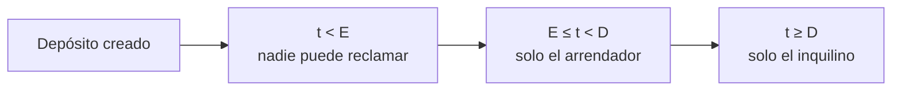

<p align="center">
  
</p>

<h1 align="center">Plazo</h1>

<p align="center">Un depósito de garantía que nadie custodia. El plazo es el juez.</p>

> **Roney Ruiz** · Entregable 1 del Pura Vida Bootcamp (Stellar).
> Práctica en **testnet**, con dinero de prueba y sin validez legal.

## Qué es

En un depósito de garantía (casa, carro, equipo) el dinero queda en manos del arrendador, y si nadie hace nada, sigue ahí. Plazo invierte ese default: el depósito se bloquea en la red Stellar con reglas de tiempo, y si el arrendador no actúa a tiempo, el inquilino puede recuperarlo sin pedir permiso a nadie.

Se apoya en los *claimable balances* de Stellar: la red, no una persona, decide quién puede retirar el dinero en cada momento.

## Cómo funciona

`E` es el fin del contrato y `D` el plazo límite de reclamo, con `E < D`.



Si el arrendador no hace nada entre `E` y `D`, el inquilino recupera el depósito después de `D`. Para cobrar, el inquilino firma una transacción de reclamo y paga una comisión mínima.

## Funcionalidades

- Conectar la wallet Varial en testnet y ver dirección, saldo e indicador de red.
- Crear un depósito indicando arrendador, monto, `E` y `D`, con una vista previa en lenguaje natural antes de firmar.
- Ver los depósitos de la cuenta conectada, con su rol, estado y cuenta regresiva.
- Reclamar (arrendador) o recuperar (inquilino) cuando las reglas de tiempo lo permiten.
- Compartir un link `/depositos/<id>` para que el arrendador encuentre el depósito.
- **Modo demo:** `E` y `D` en minutos para probar el flujo completo.
- Errores de la red traducidos a mensajes claros en español.

| Ruta | Pantalla |
|---|---|
| `/` | Inicio: conectar wallet, saldo y atajos |
| `/crear` | Crear depósito |
| `/depositos` | Mis depósitos |
| `/depositos/:id` | Un depósito por su link |

> **Estado:** funcional en testnet. Probado de punta a punta con dos cuentas: el arrendador reclama dentro de su ventana y, si nadie reclama, el inquilino recupera el depósito después de `D`.

## Límites

- No hay árbitro: la cadena decide quién puede actuar y cuándo, no si hubo daño.
- En la v1, el arrendador puede llevarse el 100 % del depósito dentro de su ventana.
- El tiempo lo da la red (hora de cierre del ledger), así que cerca de `E` o `D` puede haber diferencias de segundos.
- XLM cambia de precio; algo real usaría una stablecoin. Solo se usa XLM nativo.
- Solo funciona con la extensión de navegador de Varial; la app no detecta sola un cambio de cuenta, hay que recargar la página.
- Los depósitos se listan con Horizon (hasta 200 por cuenta). Si Horizon falla, se muestran solo los guardados en el navegador o abiertos por link, leídos con RPC.
- No incluye el tope de reparaciones: el arrendador reclama el balance completo.
- Ambas partes necesitan una wallet y algo de XLM para comisiones.
- Es una práctica: no sustituye ningún contrato.

## Tecnologías

React, React Router, TypeScript, Vite, Tailwind CSS, Vitest, `@stellar/stellar-sdk` y `@stellar/varial-sdk`.

## Cómo ejecutarlo

Requiere [Bun](https://bun.sh) y la extensión de [Varial](https://developers.stellar.org/docs/tools/developer-tools/wallets) en el navegador, configurada en testnet.

```sh
bun install
bun run dev      # servidor local
bun run test     # tests de entity
bun run build    # compilación de producción
```

Para probar el flujo completo se necesitan **dos cuentas de testnet** (inquilino y arrendador), distintas entre sí, fondeadas con [Friendbot](https://friendbot.stellar.org) (la app ofrece el enlace cuando la cuenta no tiene fondos). Cada vez que cambies de cuenta en Varial, recarga la página.

1. Con la cuenta del inquilino, ve a **Crear**, pega la dirección del arrendador, elige **100 XLM** y el atajo **2 y 5 min** del modo demo (`E` en +2 min y `D` en +5 min), y firma.
2. Con la cuenta del arrendador, abre **Mis depósitos**. Antes de `E` no hay botón: nadie puede reclamar.
3. Entre `E` y `D` aparece **Reclamar depósito**. El arrendador lo reclama y la tarjeta pasa a "Reclamado".
4. Con otro depósito, si nadie reclama, pasado `D` el inquilino ve **Recuperar depósito** y lo cobra.

## Cómo usé Stellar Raven

Usé Stellar Raven (servidor MCP) desde Claude Code antes y durante la construcción, para no asumir nombres ni comportamientos.

**Qué consulté**
- Cómo integrar Varial en una app web: el skill `stellar-dev.dapp` (sección de wallets) dio el flujo `isConnected` → `requestAccess` → `getAddress` / `getNetwork` → `signTransaction`, y que los errores llegan en `{ error }` en vez de lanzarse.
- La guía de claimable balances y su sección de problemas comunes (`CannotClaim`, `NoTrust`), y cómo se arma una transacción con el SDK.

**Qué verifiqué**
- Nombres y firmas exactos de `@stellar/varial-sdk` (es un fork de la API de Freighter) y de `@stellar/stellar-sdk` v17, contra los tipos del paquete instalado: `Claimant`, `Operation.createClaimableBalance`, `TransactionBuilder.fromXdr`, `Transaction.getClaimableBalanceId`, `TransactionFailedError.getResultCodes` y `rpc.Server.getClaimableBalance`.
- El estado de Horizon en testnet: responde, y listar balances por claimant funciona.
- El comportamiento real en testnet con cuentas de prueba: los predicados salen como `abs_before_epoch` en segundos; reclamar fuera de ventana da `op_cannot_claim`; reclamar de nuevo da `op_does_not_exist`; el ID calculado antes de enviar coincide con el que lista Horizon; y la lectura por ID con RPC devuelve el mismo balance.

**Qué corrigió**
- El ejemplo de `createClaimableBalance` en la documentación del SDK usa milisegundos para el predicado de tiempo, pero `predicateBeforeAbsoluteTime` espera segundos Unix; lo comprobé en testnet y uso segundos.
- `TransactionBuilder.fromXDR` está deprecado; uso `fromXdr`.
- `getAddress` devuelve una dirección vacía hasta que la app tiene permiso, así que se conecta con `requestAccess` y no solo con `getAddress`.
- El ID del balance se obtiene con `getClaimableBalanceId`, sin tener que decodificar el resultado de la transacción.

## Documentación

- [`context/approach.md`](context/approach.md): la idea y el alcance.
- [`context/structure.md`](context/structure.md): arquitectura y flujos.
- [`context/expertise.md`](context/expertise.md): tecnicismos de Stellar.
