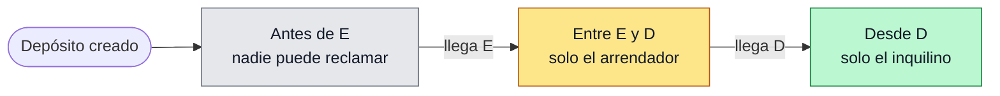

# Plazo — Approach

> Práctica de aprendizaje y entrega de la Tarea 1 del Pura Vida Bootcamp (Stellar).
> **No es un producto real:** opera solo en testnet, con dinero de prueba, y no sustituye ningún contrato.
> **Estado:** borrador v1. Las decisiones de diseño están cerradas (sección 9).

**Dónde leer qué:** este archivo explica *qué* y *por qué*; [`structure.md`](structure.md) explica *cómo se construye*; [`expertise.md`](expertise.md) explica *los tecnicismos de Stellar*.

## 1. La idea en una frase

Un depósito de garantía que **nadie custodia**: queda bloqueado en la red Stellar con reglas de tiempo y, si el arrendador no actúa a tiempo, el dinero queda disponible para el inquilino. **El plazo es el juez.**

## 2. El problema

En un depósito de garantía (casa, carro, equipo) el estado por defecto favorece a quien tiene el dinero:

| Problema | Qué pasa |
|---|---|
| Asimetría de poder | El arrendador custodia el dinero; el inquilino depende de que lo devuelva, y de cuándo. |
| El silencio no significa nada | No hay una fecha desde la cual la devolución sea automática. Si nadie hace nada, el dinero sigue con quien lo retiene. |
| No hay árbitro barato | Un abogado o una plataforma lo resuelven, pero cobran y exigen confiar en ellos. |

## 3. La solución: invertir el default

El depósito no lo tiene ninguna de las dos partes. Se bloquea en la red Stellar dentro de un *claimable balance* con reglas de tiempo. Quién puede retirarlo en cada momento lo decide la red, no una persona.

### Actores y variables

| Nombre | Qué es |
|---|---|
| **Inquilino** | Crea el depósito y aporta el dinero. |
| **Arrendador** | Solo puede reclamar dentro de una ventana de tiempo. |
| `E` | Fin del contrato: inicio de la ventana del arrendador. |
| `D` | Plazo límite de reclamo: fin de la ventana. Siempre `E < D`. |
| `monto` | Cantidad depositada (XLM de testnet en v1). |

### Quién puede reclamar y cuándo

| Momento | Arrendador | Inquilino |
|---|---|---|
| `t < E` | no puede | no puede |
| `E ≤ t < D` | **puede** | no puede |
| `t ≥ D` | no puede | **puede** |

Quien reclama primero cierra el depósito: el balance se elimina y nadie más puede cobrarlo.

**Regla de oro:** si el arrendador no hace nada entre `E` y `D`, el inquilino puede recuperar el depósito después de `D`, sin pedir permiso a nadie.

### Matices

- "Automático" significa **que no hace falta el permiso de nadie**, no que el dinero se mueva solo. Después de `D` el inquilino debe firmar una transacción de reclamo y pagar una comisión mínima.
- Antes de `E` nadie puede reclamar, así que el arrendador no se lleva el depósito al día siguiente de firmar.
- En v1, si el arrendador reclama dentro de su ventana se lleva el balance completo (ver [límites](#5-límites-honestos)).

## 4. Por qué blockchain

| Aporta | No aporta |
|---|---|
| Una regla simple, binaria y basada en tiempo, que la red hace cumplir. | Una capacidad imposible de lograr de otra forma: un notario o un escrow bancario logran algo parecido. |
| Ninguna parte custodia el dinero. | |
| Ambas partes verifican el mismo registro público. | |
| Sin intermediario al que pagar ni en quien confiar. | |

La ventaja es **costo y neutralidad**. Decirlo así es parte del aprendizaje.

## 5. Límites honestos

Material directo para el README del PR.

1. **No hay árbitro.** La cadena no sabe si el daño existió; solo decide quién puede actuar y cuándo.
2. **El arrendador puede llevarse el 100 % en su ventana.** Mitigación (reto): dos balances en una sola transacción: un *fondo de reparaciones* con tope porcentual y el resto reclamable por el inquilino desde `E`.
3. **Volatilidad.** XLM cambia de precio; algo real usaría una stablecoin.
4. **Ambas partes necesitan wallet** y algo de XLM para comisiones.
5. **Sin respaldo legal.** Es una práctica, no un contrato.
6. **El tiempo lo da la red.** Los predicados usan la hora de cierre del ledger, no el reloj del usuario; cerca de `E` o `D` puede haber diferencias de segundos.
7. **Un árbitro real requeriría multifirma** (2 de 3). Queda como v2.

## 6. Alcance

| Nivel | Incluye |
|---|---|
| **v1 (MVP)** | Conectar Varial (testnet) y mostrar dirección y saldo · crear depósito (un balance, XLM nativo) con arrendador, monto, `E` y `D` · listar depósitos de la cuenta con rol y estado · reclamar cuando el predicado lo permita · **modo demo** (`E` y `D` en minutos) · errores legibles. |
| **Reto** (si da tiempo) | Tope de reparaciones (dos balances) · evaluador de predicados con cuenta regresiva · link `?deposit=<id>` para que el arrendador encuentre el depósito · activo de prueba en vez de XLM (aprender trustlines). |
| **Fuera de alcance** | Backend propio, mainnet, arbitraje, notificaciones, stablecoins reales, identidad/KYC, validez legal. |

## 7. Entrega de la Tarea 1

Construida sobre Stellar, con Stellar Raven como asistente (documentar su uso en el README). La pantalla 1 de la app cumple el requisito de conectar la wallet.

1. Fork de `Oppia-Software-Labs/Pura-Vida-Bootcamp-1`.
2. Carpeta con el nombre completo en la raíz del fork, con una copia del proyecto.
3. Rama `feature/<nombre>`.
4. Al menos 5 commits propios.
5. PR a `main` del repo original, con el nombre completo en la descripción.
6. Pegar el link del PR en la plataforma.

**Cierre:** miércoles 18 de noviembre, 19:00.

## 8. Criterio de éxito

1. Demo completa en testnet con dos cuentas (inquilino y arrendador).
2. **Corrida A** (`E` = +2 min, `D` = +5 min): antes de `E` nadie reclama; en la ventana el arrendador reclama.
3. **Corrida B:** nadie reclama; pasado `D`, el inquilino recupera el depósito.
4. Quien construyó la app explica cada predicado y cada decisión sin mirar el código.

## 9. Decisiones tomadas

| Tema | Decisión | Por qué |
|---|---|---|
| Nombre | **Plazo** | Ya está en el repo y describe la idea: el plazo es el juez. |
| Tope de reparaciones | **Reto**, después del MVP | Primero el flujo completo con un solo balance. |
| Activo | **XLM nativo** | Sin trustlines; Friendbot lo da gratis. |
| Idioma de la UI | **Solo español** | El código y sus errores siguen en inglés; la UI traduce. |
| Descubrir depósitos | **Horizon + link `?deposit=<id>`** | Se lista con Horizon mientras responda; el link lee por RPC si Horizon falla. |
| Entrega | **Repo propio, copiado al fork al final** | Historial limpio aquí; al cerrar se copia a la carpeta con el nombre completo (paso 2 de la sección 7). |
