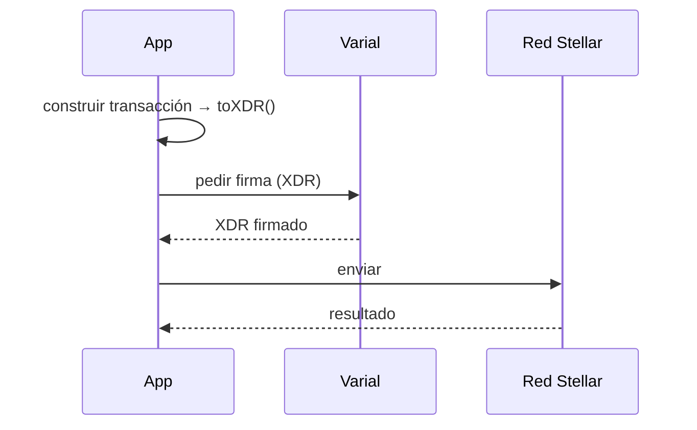
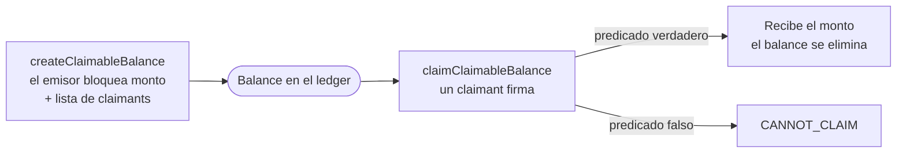

# Plazo — Expertise

> Tecnicismos de Stellar explicados, lo necesario para construir y defender Plazo.
> Los bloques de código son **bocetos orientativos**: confirmar nombres exactos de métodos y paquetes con Stellar Raven (ver [sección 12](#12-verificar-con-raven-antes-de-dar-algo-por-cierto)).
> Contexto en [`approach.md`](approach.md); arquitectura en [`structure.md`](structure.md).

## Contenido

1. [Stellar en 5 minutos](#1-stellar-en-5-minutos)
2. [Cuentas, reserva y sponsorship](#2-cuentas-reserva-y-sponsorship)
3. [Transacciones y operaciones](#3-transacciones-y-operaciones)
4. [Wallets](#4-wallets)
5. [Claimable balances](#5-claimable-balances)
6. [Predicados](#6-predicados)
7. [El tiempo en Stellar](#7-el-tiempo-en-stellar)
8. [Dinero y precisión](#8-dinero-y-precisión)
9. [Horizon vs RPC](#9-consultar-el-estado-horizon-vs-rpc)
10. [Errores comunes](#10-errores-comunes-y-cómo-mostrarlos)
11. [Seguridad mínima](#11-seguridad-mínima)
12. [Verificar con Raven](#12-verificar-con-raven-antes-de-dar-algo-por-cierto)
13. [Glosario](#13-glosario)
14. [Fuentes](#14-fuentes)

---

## 1. Stellar en 5 minutos

| Concepto | Qué es |
|---|---|
| **Stellar** | Blockchain pública para mover valor. Plazo **no usa Soroban** (contratos): usa funciones nativas del protocolo. |
| **Cuenta** | Se identifica con una llave pública (`G...`) y se controla con la secreta (`S...`), que **nunca** debe tocar la app ni el repositorio. |
| **XLM** | Moneda nativa, para comisiones y reservas. Unidad mínima: el **stroop**, `1 XLM = 10 000 000 stroops` (7 decimales). |
| **Testnet / mainnet** | Testnet es una copia de práctica con dinero sin valor. **Friendbot** fondea cuentas de testnet gratis. Todo Plazo vive en testnet. |
| **Network passphrase** | Texto que identifica la red y entra en la firma: una transacción firmada para testnet no vale en mainnet. Sale de `Networks.TESTNET`. |
| **Comisión base** | 100 stroops (0.00001 XLM) por operación. |
| **Ledger** | El "bloque" de la red; cierra cada ~5 s. Su **hora de cierre** es el reloj del protocolo. |

## 2. Cuentas, reserva y sponsorship

- Toda cuenta debe mantener un **saldo mínimo**: reserva base × (2 + entradas que posee). Cada cosa que la cuenta tiene en el ledger sube ese mínimo.
- Un claimable balance es una entrada del ledger: **cada claimant suma una reserva base** a la cuenta que lo crea. La reserva se libera cuando el balance se reclama.
- **Consecuencia:** el inquilino necesita **monto + comisión + reservas**. Si falla con `LOW_RESERVE` o `UNDERFUNDED`, falta saldo.
- La reserva base actual (0.5 XLM) debe verificarse con Raven.

## 3. Transacciones y operaciones

- Una **transacción** agrupa de 1 a 100 **operaciones** y es **atómica**: o todas funcionan o ninguna. Por eso el tope de reparaciones crea sus dos balances juntos o ninguno.
- **Sequence number:** contador de la cuenta; cada transacción usa el siguiente. El SDK lo gestiona al cargar la cuenta.
- **XDR:** formato binario (en base64) que serializa las transacciones.
- **Time bounds de la transacción:** ventana en que la transacción puede entrar a un ledger (en el SDK, p. ej. `setTimeout(180)`). **No confundir** con los predicados del claimable balance: son cosas distintas.

### Flujo de firma



**La wallet firma pero no envía:** eso lo hace la app.

## 4. Wallets

- Una wallet guarda llaves y firma por el usuario. **Varial** (antes Freighter) es la wallet oficial de la Stellar Foundation: extensión de navegador, con versión móvil.
- **Conectar wallet** es pedirle permiso para leer la dirección pública. No se comparte ninguna llave secreta.
- **`@stellar/varial-sdk`** es el SDK cliente: la app habla directo con la extensión, sin kit multi-wallet. Se usa una sola wallet.
- Para firmar, la app envía un XDR y recibe el XDR firmado. Confirmar los nombres exactos de las funciones antes de codificar.
- Si la wallet está en otra red que la app, la firma falla o es inválida: verificar que ambas estén en testnet.

## 5. Claimable balances

El corazón de Plazo. Un claimable balance divide un pago en dos pasos:



Reglas que importan:

- **Los predicados se evalúan al reclamar, no al crear.**
- **Gana el primero que reclama con éxito.** El balance es indivisible y se elimina al primer reclamo.
- **Máximo 10 claimants, sin repetir cuenta.** Por eso inquilino y arrendador deben ser cuentas distintas (y para probar hacen falta dos).
- **El emisor no recupera nada por serlo.** Si no se incluye como claimant, no recupera el dinero. En Plazo el inquilino **siempre** es claimant (validar en la UI).
- **Activos no nativos** requieren trustline (el emisor al crear, el claimant al reclamar). Con XLM nativo no hace falta.
- El ID del balance es un hash derivado de la operación que lo creó; sirve para consultarlo y reclamarlo.

## 6. Predicados

Un predicado es una condición de tiempo que se combina con lógica:

| Predicado | Significado |
|---|---|
| `unconditional` | siempre verdadero |
| `before_absolute_time(T)` | verdadero si la hora de cierre del ledger es **menor** que `T` (segundos Unix) |
| `before_relative_time(s)` | verdadero hasta `s` segundos después del cierre del ledger que creó el balance |
| `and(a, b)` | ambos verdaderos |
| `or(a, b)` | alguno verdadero |
| `not(a)` | negación |

`and` y `or` toman exactamente dos sub-predicados; se anidan para más.

### Los predicados de Plazo

Con `E` = fin de contrato y `D` = plazo, ambos en segundos Unix. Plazo usa solo tiempo **absoluto**: es más fácil de razonar y de mostrar en la UI.

```
Arrendador: AND( NOT(before(E)), before(D) )   → verdadero en  E ≤ t < D
Inquilino:  NOT( before(D) )                   → verdadero en  t ≥ D
```

`before(X)` significa `t < X`:

| Momento | `before(E)` | `before(D)` | Arrendador | Inquilino |
|---|---|---|---|---|
| `t < E` | V | V | F | F |
| `E ≤ t < D` | F | V | **V** | F |
| `t ≥ D` | F | F | F | **V** |

**Bordes:** en `t == E` ya puede reclamar el arrendador; en `t == D` ya no puede, y sí el inquilino. Validar siempre `E < D` y `E` en el futuro.

### Boceto con el SDK

El tiempo se pasa como string. Confirmar firmas exactas con Raven.

```ts
import { Claimant } from "@stellar/stellar-sdk";

const landlord = new Claimant(
  LANDLORD_G,
  Claimant.predicateAnd(
    Claimant.predicateNot(Claimant.predicateBeforeAbsoluteTime(String(E))),
    Claimant.predicateBeforeAbsoluteTime(String(D)),
  ),
);

const tenant = new Claimant(
  TENANT_G,
  Claimant.predicateNot(Claimant.predicateBeforeAbsoluteTime(String(D))),
);
```

## 7. El tiempo en Stellar

- El tiempo oficial para los predicados es la **hora de cierre del ledger** en que entra la transacción de reclamo, no el reloj del navegador.
- **Consecuencia:** una transacción enviada a las 11:59:58 puede entrar en un ledger de las 12:00:03. Si `D` es 12:00:00, el arrendador **ya no** puede reclamar. La UI debe advertir un margen (15 a 30 s) y no prometer precisión al segundo.
- Para el estado en pantalla ("¿puedo reclamar ya?") basta el reloj del cliente más un margen. Alternativa más rigurosa: la hora de cierre del último ledger que reporta la API.
- **Modo demo:** `E = ahora + 2 min`, `D = ahora + 5 min`, para probar todo el flujo en minutos.

## 8. Dinero y precisión

- Los montos en Stellar son strings con hasta 7 decimales. **Nunca usar `number` de JS para dinero**: `0.1 + 0.2 !== 0.3`.
- Convertir a stroops (`BigInt`), calcular y volver a string con 7 decimales.
- Tope de reparaciones con `repairCapBps` (puntos base, `3000` = 30 %):

```ts
const total = toStroops("100");                  // 1_000_000_000n
const repairs = (total * BigInt(repairCapBps)) / 10_000n;
const rest = total - repairs;                    // el resto absorbe el redondeo
```

La suma de ambos balances debe ser **exactamente** el total: el resto se calcula por resta, no por porcentaje.

## 9. Consultar el estado: Horizon vs RPC

Riesgo real de diseño.

| | Horizon | Stellar RPC |
|---|---|---|
| Qué es | API REST histórica | API nueva, sucesora de Horizon |
| Listar balances de una cuenta | `GET /claimable_balances?claimant=G...` (SDK: `server.claimableBalances().claimant(G).call()`) | **sin equivalente directo** |
| Leer un balance por ID | sí | sí, con `getLedgerEntries` |
| Estado | cerca del fin de vida según la documentación | recomendada |

**Implicaciones de diseño:**

1. Para v1 se puede listar con Horizon mientras responda en testnet (verificarlo en el segundo commit).
2. Para no depender de él, el flujo debe permitir **descubrir un depósito por su ID** (link compartible) y leerlo con RPC.
3. El ID del balance sale del resultado de la transacción de creación (verificar con Raven cómo extraerlo).

La forma del predicado en la respuesta de Horizon (verificar con una respuesta real): objeto con claves `and` / `or` / `not` / `abs_before` (más `abs_before_epoch`) / `rel_before`, o `unconditional`.

### Evaluador de predicados (reto de aprendizaje)

El SDK no trae un método para resolver "¿puedo reclamar ahora?". Hay que escribir una función recursiva sobre la forma JSON:

```ts
type Pred =
  | { unconditional: true }
  | { and: [Pred, Pred] }
  | { or: [Pred, Pred] }
  | { not: Pred }
  | { abs_before_epoch: string }; // rel_before: no usado en Plazo

function evalPred(p: Pred, nowSec: number): boolean {
  if ("unconditional" in p) return true;
  if ("and" in p) return evalPred(p.and[0], nowSec) && evalPred(p.and[1], nowSec);
  if ("or" in p) return evalPred(p.or[0], nowSec) || evalPred(p.or[1], nowSec);
  if ("not" in p) return !evalPred(p.not, nowSec);
  return nowSec < Number(p.abs_before_epoch);
}
```

Es una función pura: se prueba con tests unitarios sin red ni wallet.

## 10. Errores comunes y cómo mostrarlos

| Situación | Causa probable | Mensaje sugerido |
|---|---|---|
| `LOW_RESERVE` / `UNDERFUNDED` al crear | falta saldo para monto + reservas + comisión | "Te falta XLM para cubrir el depósito y la reserva." |
| `MALFORMED` al crear | claimants repetidos, monto ≤ 0, predicado inválido | "Los datos del depósito no son válidos." |
| `NO_TRUST` | activo no nativo sin trustline | "Falta habilitar el activo en tu cuenta." |
| `CANNOT_CLAIM` al reclamar | el predicado es falso ahora | "Todavía no (o ya no) puedes reclamar este depósito." |
| `DOES_NOT_EXIST` al reclamar | ya fue reclamado | "Este depósito ya fue reclamado." |
| `tx_bad_seq` | secuencia desactualizada | "Intenta de nuevo." |
| Firma rechazada | el usuario canceló, o red equivocada en la wallet | "La wallet no firmó. Verifica que esté en testnet." |

Los mensajes de la tabla son para la UI; los que produzca el código llevan el idioma que fije la regla de código del proyecto. Confirmar los códigos exactos con Raven y con respuestas reales de testnet.

## 11. Seguridad mínima

- **Nunca** pedir, guardar ni registrar una llave secreta o frase semilla.
- Usar una **cuenta de desarrollo**, distinta de cualquier cuenta con fondos reales.
- Validar direcciones con `StrKey.isValidEd25519PublicKey`.
- Mostrar al usuario **qué va a firmar** (monto, reglas, fechas) antes de abrir la wallet.
- Fijar la red a testnet en un solo lugar de configuración.

## 12. Verificar con Raven antes de dar algo por cierto

- [ ] Nombres exactos en el SDK de JS: `Claimant.*`, `Operation.createClaimableBalance`, `Operation.claimClaimableBalance`.
- [ ] Que `GET /claimable_balances?claimant=` responda hoy en Horizon testnet.
- [ ] Forma real del predicado en el JSON de Horizon.
- [ ] Cómo obtener el `balanceId` del resultado de la transacción de creación.
- [ ] Nombres de funciones e imports de `@stellar/varial-sdk`.
- [ ] Reserva base actual y valor de Friendbot.
- [ ] Códigos de error exactos al crear y reclamar.

## 13. Glosario

| Término | Significado |
|---|---|
| **Claimant** | Cuenta autorizada a reclamar un balance bajo cierto predicado. |
| **Predicado** | Condición (de tiempo) que debe cumplirse para reclamar. |
| **Operación / transacción** | Acción individual / paquete atómico de acciones. |
| **XDR** | Formato binario de las transacciones. |
| **Horizon / RPC** | APIs para consultar y enviar a la red. |
| **Friendbot** | Servicio que fondea cuentas de testnet. |
| **Stroop** | Unidad mínima de XLM (1/10 000 000). |
| **Reserva base** | Saldo que una cuenta debe mantener por cada entrada que posee. |
| **Trustline** | Autorización de una cuenta para tener un activo no nativo. |
| **Ledger** | Bloque de la red; su hora de cierre es el reloj del protocolo. |
| **SEP-43** | Estándar de interfaz de wallets web. |

## 14. Fuentes

- [Claimable balances](https://developers.stellar.org/docs/build/guides/transactions/claimable-balances)
- [CAP-23, propuesta original](https://github.com/stellar/stellar-protocol/blob/master/core/cap-0023.md)
- [CLI: ejemplos de predicados](https://developers.stellar.org/docs/tools/cli/cookbook/tx-new-create-claimable-balance)
- [Migración de Horizon a RPC](https://developers.stellar.org/docs/data/apis/migrate-from-horizon-to-rpc.md)
- [Varial SDK](https://www.npmjs.com/package/@stellar/varial-sdk)
- [Wallets en el ecosistema](https://developers.stellar.org/docs/tools/developer-tools/wallets)
- [Stellar Raven](https://raven.stellar.org/docs)
