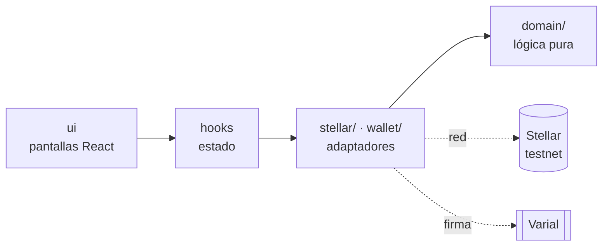
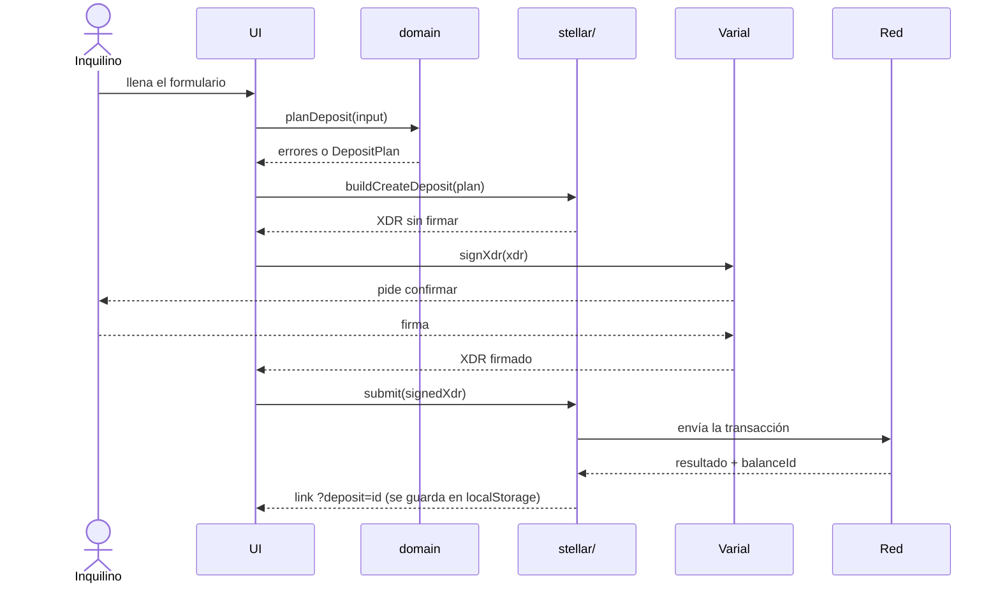
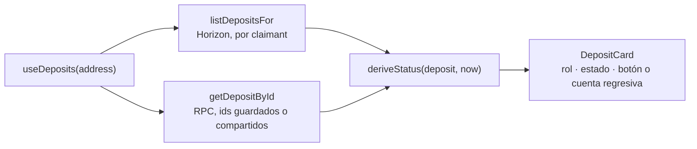
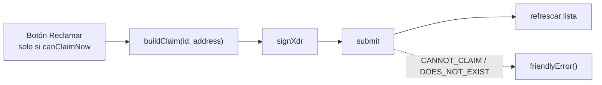

# Plazo — Structure

> Tipo de aplicación, arquitectura, librerías y flujos.
> Los nombres de archivos y funciones son **una propuesta orientativa**, no un contrato. La idea está en [`approach.md`](approach.md) y los tecnicismos en [`expertise.md`](expertise.md).

## Contenido

1. [Tipo de aplicación](#1-tipo-de-aplicación)
2. [Stack](#2-stack-y-librerías)
3. [Red](#3-configuración-de-red)
4. [Arquitectura](#4-arquitectura-en-capas)
5. [Modelo de datos](#5-modelo-de-datos)
6. [Funciones clave](#6-funciones-clave)
7. [Flujos](#7-flujos)
8. [Pantallas](#8-pantallas)
9. [Plan de commits](#9-plan-de-commits)
10. [Plan de tiempo](#10-plan-de-tiempo)
11. [Riesgos y decisiones abiertas](#11-riesgos-y-decisiones-abiertas)
12. [Checklist del README / PR](#12-checklist-del-readme--pr)

---

## 1. Tipo de aplicación

**SPA solo frontend, sin backend propio.** La fuente de verdad es la red Stellar (testnet).

- Sin base de datos ni servidor: menos piezas, y refuerza que nadie custodia nada.
- `localStorage` solo por comodidad (IDs de depósitos vistos, idioma). Nunca guarda nada crítico.
- El despliegue es opcional: el entregable es el código en el PR.

## 2. Stack y librerías

| Pieza | Elección | Motivo |
|---|---|---|
| Build / dev | **Vite** | arranque rápido |
| UI | **React + TypeScript** | los tipos ayudan con predicados y dinero |
| Estilos | **Tailwind CSS** (`@tailwindcss/vite`) | utilidades, sin librerías de UI |
| Stellar | **`@stellar/stellar-sdk`** | transacciones, claimants, Horizon y RPC |
| Wallet | **`@stellar/varial-sdk`** | una sola wallet, sin kit multi-wallet |
| Tests | **Vitest** (solo dominio) | lógica pura, sin red ni wallet |
| Gestor | **Bun** | scripts: `dev`, `build`, `lint`, `test` |

**Convenciones de código:** comillas dobles por defecto; identificadores y mensajes de error en inglés.

Confirmar nombres de paquete e imports con Raven antes de codificar (ver [`expertise.md`](expertise.md#12-verificar-con-raven-antes-de-dar-algo-por-cierto)).

## 3. Configuración de red

Un solo lugar, `source/config/network.ts`:

```ts
export const NETWORK = {
  name: "testnet",
  passphrase: "Test SDF Network ; September 2015", // o Networks.TESTNET
  horizonUrl: "https://horizon-testnet.stellar.org",
  rpcUrl: "https://soroban-testnet.stellar.org",
  friendbotUrl: "https://friendbot.stellar.org",
} as const;

export const DEMO_MODE_DEFAULT = true; // E y D en minutos
```

## 4. Arquitectura en capas



**Regla:** `domain/` no importa React, ni la wallet, ni la red. Toda regla de negocio vive ahí y se prueba con Vitest. Los adaptadores traducen entre el dominio y el mundo exterior.

### Carpetas

```
plazo/
├─ index.html
├─ vite.config.ts
├─ package.json
└─ source/
   ├─ main.tsx
   ├─ App.tsx
   ├─ index.css                  # @import "tailwindcss"
   ├─ config/
   │  └─ network.ts
   ├─ domain/                    # puro, con tests
   │  ├─ types.ts                # Deposit, DepositPlan, Role, Status
   │  ├─ money.ts                # stroops, BigInt, tope de reparaciones
   │  ├─ plan.ts                 # validar input → DepositPlan
   │  ├─ predicates.ts           # modelo propio de predicados
   │  ├─ evaluate.ts             # evalPred, nextChangeAt
   │  └─ status.ts               # estado y acción por rol
   ├─ stellar/                   # adaptadores a la red
   │  ├─ servers.ts              # Horizon.Server (y RPC)
   │  ├─ buildCreateDeposit.ts   # DepositPlan → XDR
   │  ├─ buildClaim.ts           # balanceId → XDR
   │  ├─ submit.ts               # enviar XDR firmado, extraer IDs
   │  ├─ listDeposits.ts         # consulta por claimant → Deposit[]
   │  └─ errors.ts               # códigos → mensajes legibles
   ├─ wallet/
   │  └─ varial.ts               # conectar, firmar
   └─ ui/
      ├─ ConnectWallet.tsx       # pantalla 1 (requisito de la tarea)
      ├─ CreateDeposit.tsx       # pantalla 2
      ├─ MyDeposits.tsx          # pantalla 3
      ├─ DepositCard.tsx         # rol, estado, acción
      └─ hooks/                  # useWallet, useDeposits, useNow
```

## 5. Modelo de datos

`source/domain/types.ts`:

```ts
type Role = "tenant" | "landlord";

type DepositPlan = {
  tenant: string;          // G...
  landlord: string;        // G...
  totalStroops: bigint;
  endOfContract: number;   // E, segundos Unix
  deadline: number;        // D, segundos Unix
  repairCapBps?: number;   // reto: 3000 = 30 %
};

type Status =
  | "waiting"              // t < E: nadie puede reclamar
  | "landlord_window"      // E ≤ t < D
  | "tenant_claimable"     // t ≥ D
  | "claimed";

type Deposit = {
  id: string;              // balance ID
  amountStroops: bigint;
  myRole: Role;
  status: Status;
  canClaimNow: boolean;
  nextChangeAt?: number;   // para la cuenta regresiva
};
```

Los identificadores van en inglés; la UI los muestra traducidos.

## 6. Funciones clave

| Capa | Función | Hace |
|---|---|---|
| wallet | `connectWallet()` | pide acceso a Varial y devuelve la dirección |
| wallet | `signXdr(xdr, address)` | pide a la wallet firmar (testnet) |
| domain | `planDeposit(input)` | valida y devuelve `DepositPlan` o errores |
| domain | `splitWithCap(total, bps)` | calcula reparaciones y resto con BigInt |
| domain | `landlordPredicate(E, D)` / `tenantPredicate(D)` | construye los predicados |
| domain | `evalPred(pred, nowSec)` | ¿se cumple el predicado ahora? |
| domain | `deriveStatus(deposit, nowSec)` | estado y acción por rol |
| stellar | `buildCreateDeposit(plan)` | arma la transacción (1 o 2 operaciones) y devuelve XDR |
| stellar | `buildClaim(balanceId, claimant)` | arma el reclamo y devuelve XDR |
| stellar | `submit(signedXdr)` | envía y devuelve resultado e IDs de balance |
| stellar | `listDepositsFor(address)` | consulta por claimant y mapea a `Deposit[]` |
| stellar | `getDepositById(id)` | lectura por ID (RPC; plan B de Horizon) |
| stellar | `friendlyError(err)` | traduce códigos a mensajes |

## 7. Flujos

### 7.1 Crear depósito



Validaciones previas: direcciones válidas, arrendador ≠ inquilino, `E < D`, `E` en el futuro, monto > 0, saldo suficiente (monto + reservas + comisión) y **el inquilino incluido como claimant**.

### 7.2 Ver mis depósitos



`useNow()` refresca el reloj cada segundo para actualizar estado y cuenta regresiva sin consultar la red.

### 7.3 Reclamar



## 8. Pantallas

1. **Conectar wallet:** botón para conectar Varial; muestra dirección y saldo de XLM en testnet, con indicador claro de red.
2. **Crear depósito:** arrendador (G...), monto, `E`, `D` (modo demo en minutos). **Vista previa en lenguaje natural:** "Si [arrendador] no reclama entre E y D, podrás recuperar X XLM después de D." Reto: control del tope de reparaciones.
3. **Mis depósitos:** tarjetas con rol, monto, estado, cuenta regresiva y botón de reclamar.
4. **Detalle por link (`?deposit=<id>`):** lectura de un balance concreto; permite al arrendador encontrarlo.

## 9. Plan de commits

Mínimo 5 propios. Mensajes en inglés, formato Conventional Commits.

| # | Mensaje sugerido | Contenido |
|---|---|---|
| 1 | `chore: scaffold vite app with varial sdk` | proyecto base, `network.ts` |
| 2 | `feat(wallet): connect varial on testnet` | **requisito mínimo:** dirección + saldo |
| 3 | `feat(domain): add deadline predicates and tests` | `predicates`, `evaluate`, `money`, tests |
| 4 | `feat(deposit): create deposit and sign` | `plan`, `buildCreateDeposit`, `submit`, pantalla 2 |
| 5 | `feat(deposit): list and claim deposits` | `listDeposits`, `buildClaim`, pantalla 3 |
| 6 | `docs: add readme with limits and raven use` | cierre del PR |
| 7+ | `feat: add repair cap` | reto, si da tiempo |

## 10. Plan de tiempo

Estimación aproximada.

| Cuándo | Qué |
|---|---|
| Esta noche (~2 h) | commits 1 y 2, y empezar el 3. El PR puede abrirse al terminar el 2 (o como draft). |
| Mañana temprano | commits 3 a 6, con prueba end-to-end en modo demo. |
| Antes de las 19:00 | PR final revisado y link pegado en la plataforma. No dejarlo para el último momento. |

## 11. Riesgos y decisiones abiertas

| # | Riesgo | Mitigación |
|---|---|---|
| 1 | **Horizon puede dejar de responder.** | Verificarlo en el commit 2 con una llamada simple; `getDepositById` por RPC y el link `?deposit=<id>` como camino alterno. Pendiente: ¿el link pasa a ser el mecanismo principal? |
| 2 | **Dos cuentas para probar.** | Segunda cuenta en Varial (si permite varias) o segundo perfil de navegador. Fondear ambas con Friendbot. |
| 3 | **Tiempo en los bordes.** | No prometer precisión al segundo; probar con ventanas de minutos. |
| 4 | **Nombres del SDK de Varial.** | Confirmar con Raven antes de codificar, no después. |
| 5 | **Alcance.** | Si el tiempo aprieta, sacrificar primero el tope de reparaciones y el link compartible. |

## 12. Checklist del README / PR

- [ ] Nombre completo al inicio (y en la descripción del PR).
- [ ] Qué es Plazo y qué problema ataca (versión corta de [`approach.md`](approach.md)).
- [ ] Funcionalidades y **límites honestos**.
- [ ] Tecnologías usadas.
- [ ] Cómo ejecutarlo (`bun install`, `bun run dev`) y cómo probar con dos cuentas en modo demo.
- [ ] **Cómo usé Stellar Raven:** qué consulté, qué verifiqué (nombres del SDK, estado de Horizon, imports de Varial) y qué corrigió.
- [ ] Aclaración: testnet, práctica, sin validez legal.
