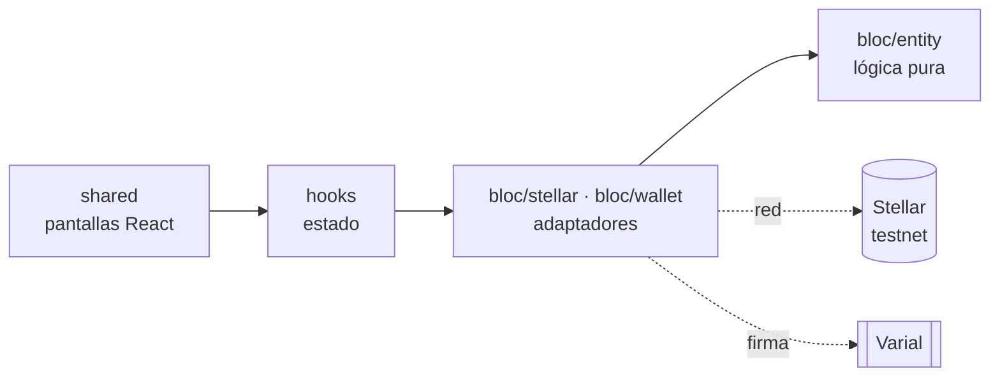
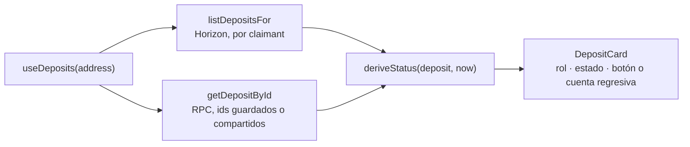
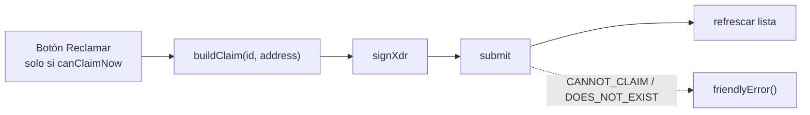

# Plazo — Structure

> Tipo de aplicación, arquitectura, librerías y flujos.
> Los nombres de archivos y funciones son **una propuesta orientativa**, no un contrato. La idea está en [`approach.md`](approach.md) y los tecnicismos en [`expertise.md`](expertise.md).

## 1. Tipo de aplicación

**SPA solo frontend, sin backend propio.** La fuente de verdad es la red Stellar (testnet).

- Sin base de datos ni servidor: menos piezas, y refuerza que nadie custodia nada.
- `localStorage` solo por comodidad (IDs de depósitos vistos). Nunca guarda nada crítico.
- El despliegue es opcional: el entregable es el código en el PR.

## 2. Stack y librerías

| Pieza | Elección | Motivo |
|---|---|---|
| Build / dev | **Vite** | arranque rápido |
| UI | **React + TypeScript** | los tipos ayudan con predicados y dinero |
| Estilos | **Tailwind CSS** (`@tailwindcss/vite`) | utilidades, sin librerías de UI |
| Stellar | **`@stellar/stellar-sdk`** | transacciones, claimants, Horizon y RPC |
| Wallet | **`@stellar/varial-sdk`** | una sola wallet, sin kit multi-wallet |
| Tests | **Vitest** (solo entity) | lógica pura, sin red ni wallet |
| Gestor | **Bun** | scripts: `dev`, `build`, `lint`, `test` |

**Convenciones de código:** comillas dobles por defecto; identificadores y errores en inglés; solo el texto visible de la UI va en español (el código lanza errores en inglés y la UI los traduce).

Confirmar nombres de paquete e imports con Raven antes de codificar (ver [`expertise.md`](expertise.md#12-verificar-con-raven-antes-de-dar-algo-por-cierto)).

## 3. Configuración de red

Un solo lugar, `source/config/network.ts`:

```ts
export const NETWORK = {
  name: "testnet",
  passphrase: "Test SDF Network ; September 2015", // o Networks.TESTNET
  horizonUrl: "https://horizon-testnet.stellar.org",
  rpcUrl: "https://soroban-testnet.stellar.org",
  friendbotUrl: "https://friendbot.stellar.org",
} as const;

export const DEMO_MODE_DEFAULT = true; // E y D en minutos
```

## 4. Arquitectura en capas



**Regla:** `bloc/entity/` no importa React, ni la wallet, ni la red. Toda regla de negocio vive ahí y se prueba con Vitest. Los adaptadores traducen entre `bloc/entity/` y el mundo exterior.

### Carpetas

```
plazo/
├─ index.html
├─ vite.config.ts
├─ package.json
└─ source/
   ├─ main.tsx
   ├─ App.tsx
   ├─ index.css                  # @import "tailwindcss"
   ├─ config/
   │  └─ network.ts
   ├─ hooks/                     # useWallet, useBalance, useCreateDeposit, useDeposits, useClaim, useNow
   ├─ bloc/
   │  ├─ entity/                 # puro, con tests
   │  │  ├─ types.ts             # Deposit, DepositPlan, Role, Status
   │  │  ├─ money.ts             # stroops, BigInt, tope de reparaciones
   │  │  ├─ plan.ts              # validar input → DepositPlan
   │  │  ├─ deposits.ts          # balance reclamable → Deposit (solo forma Plazo)
   │  │  ├─ predicates.ts        # modelo propio de predicados
   │  │  ├─ evaluate.ts          # evalPred, nextChangeAt
   │  │  └─ status.ts            # estado y acción por rol
   │  ├─ stellar/                # adaptadores a la red
   │  │  ├─ servers.ts           # Horizon.Server (y RPC)
   │  │  ├─ balance.ts           # saldo de XLM de una cuenta
   │  │  ├─ buildCreateDeposit.ts # DepositPlan → XDR
   │  │  ├─ buildClaim.ts        # balanceId → XDR
   │  │  ├─ predicate.ts         # Predicate → ClaimPredicate del SDK
   │  │  ├─ submit.ts            # enviar XDR firmado, extraer IDs
   │  │  ├─ listDeposits.ts      # Horizon, por claimant → Deposit[]
   │  │  └─ getDeposit.ts        # RPC, por ID → Deposit
   │  ├─ storage/
   │  │  └─ deposits.ts          # ids de depósitos en localStorage
   │  └─ wallet/
   │     └─ varial.ts            # conectar, firmar
   └─ shared/
      ├─ ConnectWallet.tsx       # pantalla 1 (requisito de la tarea)
      ├─ CreateDeposit.tsx       # pantalla 2
      ├─ MyDeposits.tsx          # pantalla 3: lista, link y reclamo
      ├─ DepositCard.tsx         # rol, estado, acción
      └─ friendlyError.ts        # error en inglés → mensaje en español
```

**Alias de imports:** uno por carpeta de `source/`, definidos en `tsconfig.app.json`, `vite.config.ts` y `vitest.config.ts`: `@config/*`, `@hooks/*`, `@shared/*` y `@bloc/*` (por ejemplo `@bloc/wallet/varial`).

## 5. Modelo de datos

`source/bloc/entity/types.ts`:

```ts
type Role = "tenant" | "landlord";

type DepositPlan = {
  tenant: string;          // G...
  landlord: string;        // G...
  totalStroops: bigint;
  endOfContract: number;   // E, segundos Unix
  deadline: number;        // D, segundos Unix
  repairCapBps?: number;   // reto: 3000 = 30 %
};

type Status =
  | "waiting"              // t < E: nadie puede reclamar
  | "landlord_window"      // E ≤ t < D
  | "tenant_claimable"     // t ≥ D
  | "claimed";

type Predicate =           // forma JSON de Horizon
  | { unconditional: true }
  | { and: [Predicate, Predicate] }
  | { or: [Predicate, Predicate] }
  | { not: Predicate }
  | { abs_before_epoch: string };

type Deposit = {
  id: string;              // balance ID
  amountStroops: bigint;
  myRole: Role;
  tenant: string;          // G...
  landlord: string;        // G...
  landlordPredicate: Predicate;
  tenantPredicate: Predicate;
};

type DepositState = {      // lo devuelve deriveStatus
  status: Status;
  canClaimNow: boolean;
  nextChangeAt?: number;   // para la cuenta regresiva
};
```

Los identificadores van en inglés; la UI los muestra traducidos. El estado no se guarda: se deriva de los predicados y la hora con `deriveStatus`. `claimed` no sale de los predicados (un balance reclamado ya no existe): se pasa como tercer parámetro.

## 6. Funciones clave

| Capa | Función | Hace |
|---|---|---|
| wallet | `connectWallet()` | pide acceso a Varial y devuelve la dirección |
| wallet | `signXdr(xdr, address)` | pide a la wallet firmar (testnet) |
| entity | `planDeposit(input)` | valida y devuelve `{ ok, plan }` o `{ ok: false, errors }` con códigos en inglés (`invalid_tenant`, `deadline_not_after_end`, `insufficient_balance`...) |
| entity | `xlmToStroops(xlm)` / `formatStroops(stroops)` | convierte texto de XLM a stroops `BigInt` y viceversa |
| entity | `splitWithCap(total, bps)` | calcula reparaciones y resto con BigInt |
| entity | `landlordPredicate(E, D)` / `tenantPredicate(D)` | construye los predicados |
| entity | `evalPred(pred, nowSec)` / `nextChangeAt(pred, nowSec)` | ¿se cumple ahora? y ¿cuándo cambia? |
| entity | `deriveStatus(deposit, nowSec, claimed?)` | devuelve `DepositState`: estado, `canClaimNow` y `nextChangeAt` |
| stellar | `getXlmBalance(address)` | saldo en stroops por Horizon; `null` si la cuenta no existe |
| stellar | `buildCreateDeposit(plan)` | arma la transacción (1 o 2 operaciones) y devuelve XDR |
| stellar | `buildClaim(balanceId, claimant)` | arma el reclamo y devuelve XDR |
| stellar | `submitCreateDeposit(signedXdr)` | envía y devuelve el ID del balance; los rechazos se lanzan como `Transaction rejected: <código>` |
| entity | `toDeposit(raw, myAddress)` / `parsePredicate(json)` | mapea un balance reclamable a `Deposit`; descarta lo que no tenga la forma de Plazo |
| stellar | `listDepositsFor(address)` | Horizon por claimant, mapeado a `Deposit[]` |
| stellar | `getDepositById(id, address)` | lectura por ID con RPC (`getClaimableBalance`); `null` si no existe o no es de Plazo |
| shared | `friendlyError(err)` | traduce un error en inglés a un mensaje en español |

## 7. Flujos

### 7.1 Crear depósito


Validaciones previas: direcciones válidas, arrendador ≠ inquilino, `E < D`, `E` en el futuro, monto > 0, saldo suficiente (monto + reservas + comisión) y **el inquilino incluido como claimant**.

### 7.2 Ver mis depósitos



`useNow()` refresca el reloj cada segundo para actualizar estado y cuenta regresiva sin consultar la red.

### 7.3 Reclamar



## 8. Pantallas

1. **Conectar wallet:** botón para conectar Varial; muestra dirección y saldo de XLM en testnet, con indicador claro de red.
2. **Crear depósito:** arrendador (G...), monto, `E`, `D` (modo demo en minutos). **Vista previa en lenguaje natural:** "Si [arrendador] no reclama entre E y D, podrás recuperar X XLM después de D." Reto: control del tope de reparaciones.
3. **Mis depósitos:** tarjetas con rol, monto, estado, cuenta regresiva y botón de reclamar.
4. **Detalle por link (`?deposit=<id>`):** lectura de un balance concreto; permite al arrendador encontrarlo.

## 9. Plan de commits

Mínimo 5 propios. Mensajes en inglés, formato Conventional Commits. El commit 1 ya está hecho (más `chore`, `build`, `style` y `docs` de apoyo).

| # | Mensaje sugerido | Contenido |
|---|---|---|
| 1 ✅ | `chore: scaffold vite app with varial sdk` | proyecto base |
| 2 | `feat(wallet): connect varial on testnet` | `network.ts`, `varial.ts`, pantalla 1: **requisito mínimo**, dirección + saldo |
| 3 | `feat(entity): add deadline predicates and tests` | `predicates`, `evaluate`, `money`, tests |
| 4 | `feat(deposit): create deposit and sign` | `plan`, `buildCreateDeposit`, `submit`, pantalla 2 |
| 5 | `feat(deposit): list and claim deposits` | `listDeposits`, `buildClaim`, pantalla 3 |
| 6 | `docs: add readme with limits and raven use` | cierre del PR |
| 7+ | `feat: add repair cap` | reto, si da tiempo |

## 10. Plan de tiempo

Estimación aproximada.

| Cuándo | Qué |
|---|---|
| Hoy, martes 17 (~2 h) | commits 1 y 2, y empezar el 3. El PR puede abrirse al terminar el 2 (o como draft). |
| Miércoles 18, temprano | commits 3 a 6, con prueba end-to-end en modo demo. |
| Miércoles 18, antes de las 19:00 | PR final revisado y link pegado en la plataforma. No dejarlo para el último momento. |

## 11. Riesgos

| # | Riesgo | Mitigación |
|---|---|---|
| 1 | **Horizon puede dejar de responder.** | Verificarlo en el commit 2 con una llamada simple; `getDepositById` por RPC y el link `?deposit=<id>` como camino alterno. Decidido: Horizon para listar y el link como respaldo. |
| 2 | **Dos cuentas para probar.** | Segunda cuenta en Varial (si permite varias) o segundo perfil de navegador. Fondear ambas con Friendbot. |
| 3 | **Tiempo en los bordes.** | No prometer precisión al segundo; probar con ventanas de minutos. |
| 4 | **Nombres del SDK de Varial.** | Confirmar con Raven antes de codificar, no después. |
| 5 | **Alcance.** | Si el tiempo aprieta, sacrificar primero el tope de reparaciones y el link compartible. |

## 12. Checklist del README / PR

- [ ] Nombre completo al inicio (y en la descripción del PR).
- [ ] Qué es Plazo y qué problema ataca (versión corta de [`approach.md`](approach.md)).
- [ ] Funcionalidades y **límites honestos**.
- [ ] Tecnologías usadas.
- [ ] Cómo ejecutarlo (`bun install`, `bun run dev`) y cómo probar con dos cuentas en modo demo.
- [ ] **Cómo usé Stellar Raven:** qué consulté, qué verifiqué (nombres del SDK, estado de Horizon, imports de Varial) y qué corrigió.
- [ ] Aclaración: testnet, práctica, sin validez legal.
