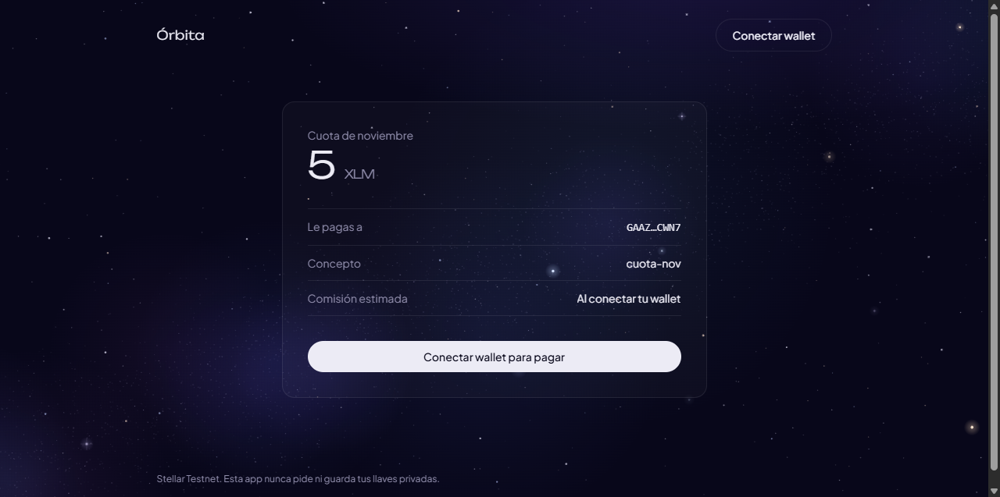
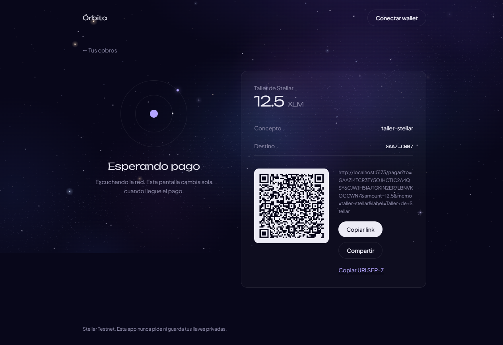
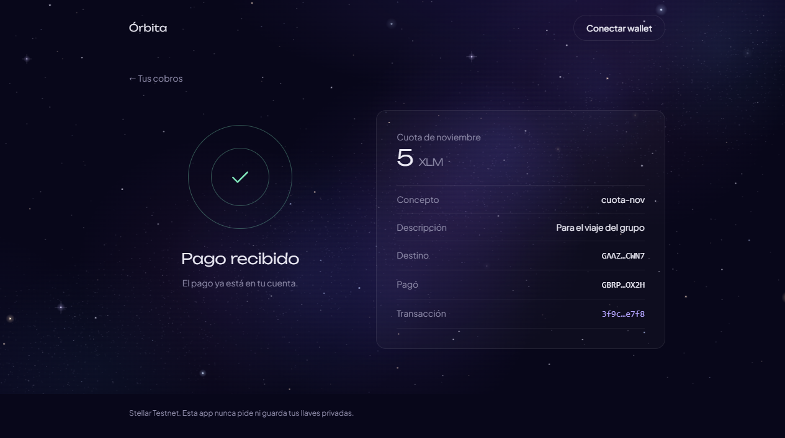
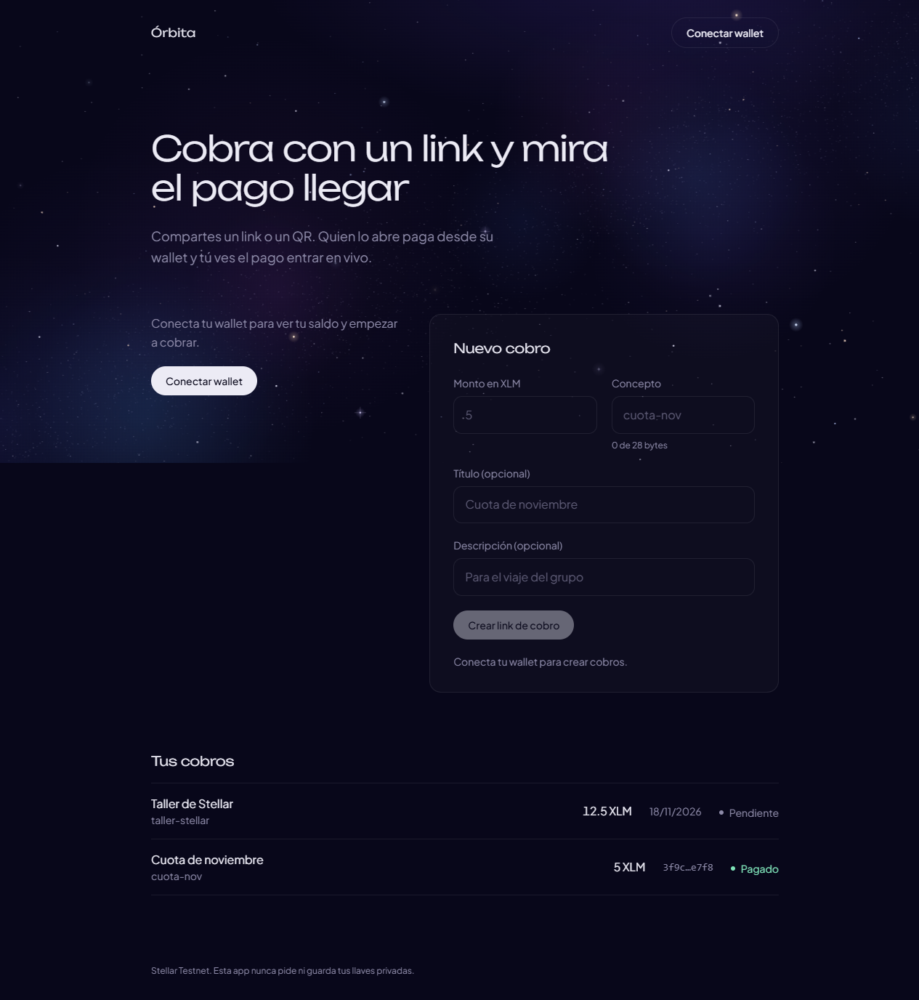
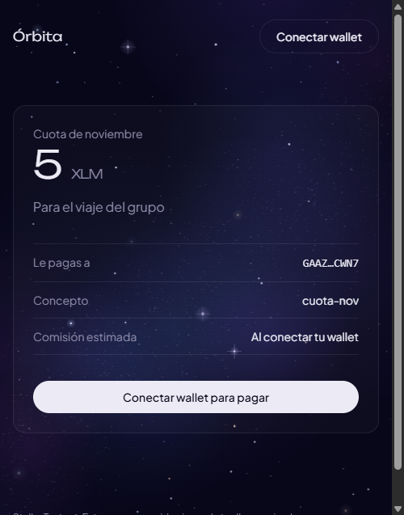

# Órbita: cobros con link y QR en Stellar

**Autor:** Joshua Calero Jiménez · Entregable 1, Pura Vida Bootcamp

Generas un link de cobro como `/pagar?to=G...&amount=5&memo=cuota-nov&label=Cuota` o su QR. Quien lo abre conecta su wallet y paga con un clic. Tú ves el pago entrar en vivo, porque la app escucha la red con el streaming de Horizon.

Solo funciona en **Stellar Testnet**. La app nunca pide ni guarda llaves privadas.

## Cómo correrla

```bash
cd joshua-calero-jimenez
npm install
npm run dev
```

Abre `http://localhost:5173`. Necesitas una wallet de Stellar en **Testnet**, como Varial (antes Freighter), xBull o Albedo.

Para probar el flujo completo usa dos cuentas:

1. **Cuenta A (cobrador):** conecta la wallet, fondéala con Friendbot si hace falta y crea un cobro.
2. Abre el link en otra ventana o escanea el QR con el celular.
3. **Cuenta B (pagador):** conecta otra wallet o cuenta y paga.
4. En la pantalla del cobro de la cuenta A, el estado pasa de *Esperando pago* a *Pagado* sin recargar.

> Para escanear el QR desde el celular en la misma red Wi-Fi, usa `npm run dev -- --host` y abre la IP que muestra Vite.

## Qué hace

| Requisito | Cómo está resuelto |
|---|---|
| RF1 Conectar wallet | Stellar Wallets Kit v2 (`authModal`). Muestra la dirección abreviada y tiene botón para desconectar. Avisa si la wallet no está en Testnet. La sesión se restaura al recargar sin volver a pedir permiso. |
| RF2 Mi cuenta | Balance en XLM, leído de Horizon Testnet. Si la cuenta da 404, muestra "Cuenta no activada" y un botón de Friendbot. |
| RF3 Crear cobro | Formulario validado: monto mayor que 0 con máximo 7 decimales y memo de hasta 28 bytes. Genera link, QR, botón de copiar y botón de compartir (Web Share API). |
| RF4 Pagar | Valida el link (StrKey, monto, memo). Revisa el saldo contando monto, comisión y reserva mínima, y comprueba que la cuenta destino exista. Arma `Operation.payment` con `Memo.text`, lo firma con la wallet y lo envía. Al final muestra un comprobante con enlace a Stellar Expert. |
| RF5 Pago en vivo | `payments().forAccount().cursor("now").join("transactions").stream()`. Compara por monto y memo; el memo sale de la transacción. Al abrir también revisa los últimos 50 pagos, por si alguno entró con la página cerrada. |
| RF6 Historial | Los cobros se guardan en localStorage con su estado (pendiente o pagado) y el hash. |
| Extra | URI SEP-7 (`web+stellar:pay?...`) para copiar. |

Errores manejados: no hay wallet instalada, firma cancelada (código -4), red equivocada, saldo insuficiente, cuenta destino inexistente, link inválido o alterado, y Horizon caído (reintenta con espera y muestra un mensaje).

## Stack

React, TypeScript, Vite, Tailwind v4, `@stellar/stellar-sdk`, `@creit.tech/stellar-wallets-kit` y `qrcode`.

## Capturas

Capturas tomadas en Testnet con cobros de ejemplo.

**Pantalla de pago (lo que ve quien abre el link)**



**Cobro esperando pago: link, QR y escucha en vivo**



**Cobro pagado: el estado cambia solo cuando entra el pago**



**Inicio: saldo, nuevo cobro e historial**



**Pago desde el celular**



## Cómo usé Stellar Raven

<!-- Completa con lo que Raven te respondió en cada consulta y qué cambiaste en el código gracias a eso. -->

1. **"Usa el skill stellar-dev.dapp para conectar Stellar Wallets Kit v2 en React con Testnet."**
   Qué respondió y qué usé:
2. **"¿Cómo construyo y envío un pago XLM con memo de texto usando stellar-sdk y Horizon Testnet?"**
   Qué respondió y qué usé:
3. **"¿Cómo hago streaming de pagos entrantes a una cuenta en Horizon y obtengo el memo de la transacción?"**
   Qué respondió y qué usé:
4. **"¿Cuál es la reserva mínima y la comisión base actual para validar el saldo antes de pagar?"**
   Qué respondió y qué usé:
5. **"¿Qué es SEP-7 y cómo armo un URI web+stellar:pay?"**
   Qué respondió y qué usé:
