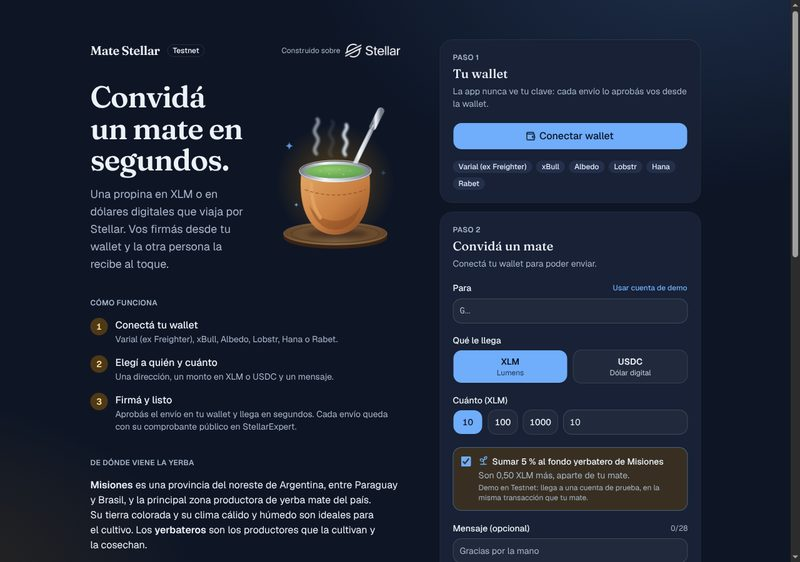
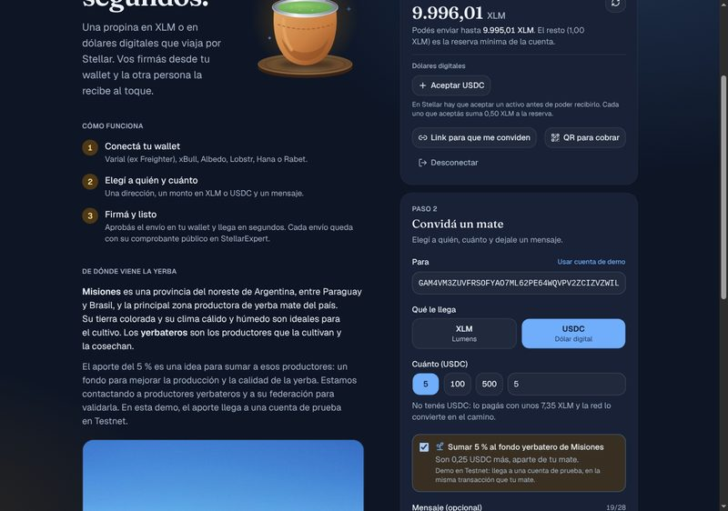
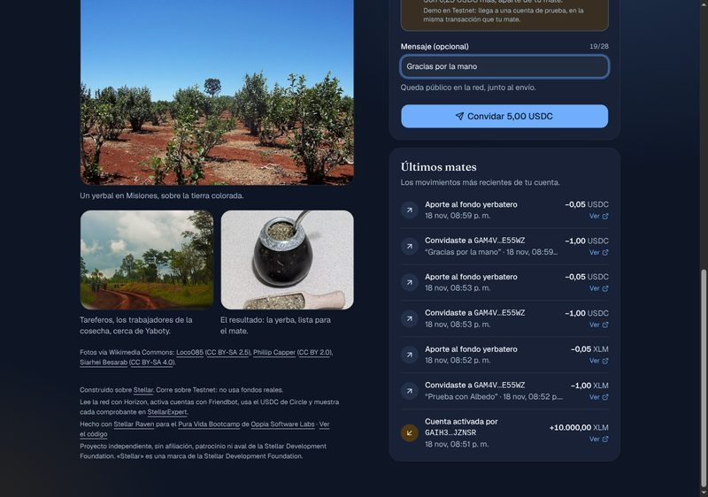
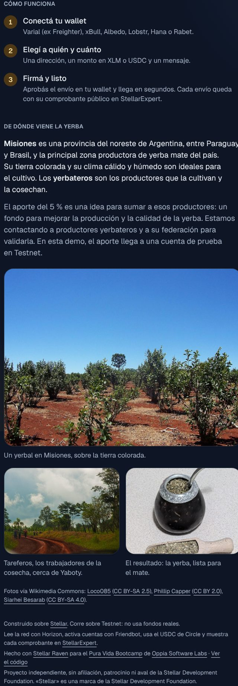

# Mate Stellar

**Entregable 1 · Pura Vida Bootcamp · Juan Facundo Ayala**

Una app para convidar un mate: una propina en XLM o en USDC que viaja por
Stellar Testnet, firmada desde la wallet de quien la envía. Si no tenés USDC,
pagás con XLM y la red lo convierte en el camino. No usa fondos reales.



## Qué hace

1. **Conectar wallet.** Un botón abre el selector de Stellar Wallets Kit con
   seis wallets: Varial (ex Freighter), xBull, Albedo, Lobstr, Hana y Rabet.
   La app nunca ve la clave privada y avisa si la wallet está en otra red.
2. **Ver el saldo.** Muestra el saldo en XLM, cuánto se puede enviar y cuánto
   queda como reserva mínima. Si la cuenta no existe en Testnet, un botón la
   activa con Friendbot.
3. **Convidar un mate en XLM o USDC.** Formulario con destinatario, activo,
   monto y mensaje. La transacción se arma en la app, se firma en la wallet y
   se envía a Horizon. Si no tenés USDC, la app cotiza en vivo cuántos XLM
   cuesta y la red hace la conversión en la misma operación.
4. **Aceptar USDC.** Un botón habilita el activo en tu cuenta para poder
   recibirlo. La app explica que eso inmoviliza 0,5 XLM más de reserva.
5. **Aporte yerbatero (demostración).** Opcional: suma un 5 % a un "fondo
   yerbatero" dentro de la misma transacción. Es una demostración: la cuenta
   del fondo es una cuenta de prueba en Testnet y no hay una cooperativa real
   detrás.
6. **Link para pedir un mate.** Copiás un link con tu dirección; quien lo abre
   encuentra el formulario ya cargado. También se muestra como código QR, para
   cobrar desde el celular o impreso. El botón "Guardar QR" lo descarga como
   imagen: sirve para mandarlo por WhatsApp, imprimirlo o pegarlo en un puesto
   y cobrar sin tener la app abierta. El link admite `?para=`, `monto=`,
   `activo=` y `mensaje=`, y descarta cualquier dato inválido.
7. **Últimos mates.** Lista pagos, conversiones, activaciones de cuenta y
   aportes, con mensaje, fecha y link al comprobante en el explorador.

## Cómo funciona el dinero

Al convidar un mate, la app arma una sola transacción de Stellar:

1. **El mate.** El monto elegido va completo y directo a la persona que lo
   recibe.
2. **El aporte (opcional).** Si está marcado, se suma un 5 % aparte, que va a
   la cuenta del fondo yerbatero. No se descuenta del mate.
3. **La conversión (si hace falta).** Si quien envía no tiene USDC, paga con
   XLM y la red lo convierte en el camino. La app muestra antes cuánto XLM
   cuesta y fija un tope.
4. **La firma.** Todo se aprueba una sola vez, desde la wallet de quien envía.

La app nunca recibe ni guarda el dinero ni las claves: solo prepara la
transacción y la wallet la firma. Cada envío queda con su comprobante público
en StellarExpert. Hoy corre en Testnet y el fondo es una cuenta de prueba.

## Decisiones sobre Stellar

- **Un activo es código y emisor.** Cualquiera puede emitir algo llamado
  "USDC". La app solo reconoce el de Circle en Testnet
  (`GBBD47IF6LWK7P7MDEVSCWR7DPUWV3NY3DTQEVFL4NAT4AQH3ZLLFLA5`) y compara las
  dos cosas tanto al leer saldos como al armar el historial
  (`src/lib/assets.ts`).
- **Trustlines y reserva.** Para recibir USDC hay que habilitarlo antes con
  `changeTrust`, y cada activo habilitado suma 0,5 XLM a la reserva mínima.
  Si el destino no lo habilitó, la app avisa antes de pedir la firma en vez de
  dejar que el envío rebote.
- **Conversión con tope.** Cuando quien envía no tiene USDC se usa
  `pathPaymentStrictReceive`: el destino recibe el monto exacto y quien envía
  fija un máximo de XLM, que es la cotización de Horizon más 1 % de margen.
  Si el precio se mueve más que eso, la red rechaza el envío en lugar de
  cobrar de más.
- **Dos operaciones, una transacción.** El mate y el aporte viajan juntos: o
  se hacen los dos envíos o no se hace ninguno. La comisión se paga por
  operación.
- **Crear la cuenta o pagar.** Un pago a una cuenta que no existe falla. Si el
  destino no existe, la app usa `createAccount` y exige el mínimo de 1 XLM.
- **Wallets elegidas a mano.** En vez de cargar todos los módulos del kit, se
  incluyen seis de las once wallets que la
  [documentación oficial de Stellar](https://developers.stellar.org/docs/tools/developer-tools/wallets)
  lista como compatibles (`src/lib/wallet.ts`).







## Cómo correrla

Requiere Node.js 22.12 o superior.

```bash
cd juan-facundo-ayala
npm install
npm run dev
```

Abrí `http://localhost:5173` en un navegador que tenga una wallet de Stellar
instalada y configurada en **Testnet**. Para probarla:

1. Tocá **Conectar wallet** y elegí la tuya.
2. Si la cuenta es nueva, tocá **Pedir XLM de prueba** (Friendbot la activa).
3. En el formulario, tocá **Usar cuenta de demo** para tener a quién enviarle.
4. Elegí XLM o USDC, poné un monto y un mensaje, y convidá el mate. Al
   terminar aparece el link al comprobante y el movimiento en el historial.

Otros comandos:

| Comando          | Qué hace                           |
| ---------------- | ---------------------------------- |
| `npm run build`  | Revisa los tipos y compila         |
| `npm test`       | Corre los tests unitarios (Vitest) |
| `npm run lint`   | Revisa el código con oxlint        |
| `npm run format` | Ordena el código con Prettier      |

## Cómo se usó Stellar Raven

Desarrollada con asistentes de IA de programación, entre ellos Claude Code, con
Stellar Raven como fuente sobre Stellar.

Raven es el MCP oficial de Stellar: una herramienta de consulta sobre la
documentación y las guías de desarrollo. Cada parte de la app salió de una
consulta concreta:

| Consulta a Raven                                  | Qué aportó                                                                                             | Dónde quedó                             |
| ------------------------------------------------- | ------------------------------------------------------------------------------------------------------ | --------------------------------------- |
| Cómo conectar una wallet desde un frontend        | El patrón de Stellar Wallets Kit v2: singleton estático, `authModal()`, `signTransaction()`            | `src/lib/wallet.ts`                     |
| Cómo armar y enviar un pago                       | `TransactionBuilder` con `BASE_FEE`, `setTimeout(180)` y el envío con `horizon.submitTransaction`      | `src/lib/mate.ts`                       |
| Qué pasa si el destino no existe                  | Un pago a una cuenta inexistente falla; hay que usar `createAccount` con al menos 1 XLM                | `src/lib/mate.ts`                       |
| Saldo mínimo y reservas                           | Dos reservas base más una por subentrada, a 0,5 XLM cada una; las ofertas abiertas también inmovilizan | `src/lib/account.ts`                    |
| Friendbot                                         | Entrega 10.000 XLM de prueba, limita los pedidos, y su URL                                             | `src/lib/account.ts`                    |
| Límite del memo                                   | Memo de texto de hasta 28 bytes, no 28 caracteres                                                      | `src/lib/mate.ts`, `src/lib/link.ts`    |
| Códigos de error                                  | El significado de `tx_bad_seq`, `tx_too_late`, `op_underfunded`, `op_no_destination` y otros           | `src/lib/mate.ts`                       |
| Pagos de una cuenta en Horizon                    | `GET /accounts/{id}/payments` con `order`, `limit` y `join=transactions`                               | `src/lib/history.ts`                    |
| Comisión mínima                                   | 100 stroops por operación; lo que se declara es un tope, no un precio fijo                             | `src/lib/mate.ts`, `src/lib/account.ts` |
| Direcciones muxed (M...)                          | Pueden ser destino de un pago; la app todavía no las acepta                                            | `src/lib/mate.ts`                       |
| Emisor de USDC en Testnet (documentación oficial) | La cuenta emisora de Circle, para validar el activo por código y emisor                                | `src/lib/assets.ts`                     |

Raven también corrigió y aclaró cosas: que Freighter ahora se distribuye como
Varial, que la v2 de Wallets Kit se publica en JSR y npm se mantiene a la par
solo por ahora, y que `tx_bad_seq` es el único rechazo que puede volverse
válido más adelante. El registro completo, con las fuentes y con lo que Raven
no devolvió, está en [docs/raven.md](docs/raven.md).

## Tecnologías

- Vite + React 19 + TypeScript
- `@stellar/stellar-sdk` para armar transacciones y leer Horizon
- `@creit.tech/stellar-wallets-kit` v2 para la conexión multi-wallet
- Tailwind CSS v4 + shadcn/ui para la interfaz
- Vitest para los tests, oxlint y Prettier para el código

## Estructura

```
src/
  lib/
    config.ts    red, Horizon y links al explorador
    assets.ts    activos aceptados, validados por código y emisor
    wallet.ts    Stellar Wallets Kit: conectar, firmar, errores
    account.ts   saldo, reserva mínima y Friendbot
    mate.ts      armado y envío de transacciones, cotización, errores
    link.ts      link para pedir un mate
    history.ts   últimos movimientos de la cuenta
    *.test.ts    tests unitarios
  hooks/         estado de la wallet y de la cuenta
  components/    secciones de la app y componentes de interfaz (ui/)
docs/            capturas y registro de consultas a Raven
public/misiones/ fotos de la sección sobre Misiones
```

## Pruebas

**Automáticas.** `npm test` corre 101 tests unitarios en 6 archivos
(`src/lib/*.test.ts`): reservas, activos, armado de transacciones, links e
historial.

**Manual en Testnet (18/11/2026).** Con una wallet de prueba inyectada en el
navegador, que firma con una clave descartable, se probó:

- activar una cuenta;
- un mate en XLM con aporte (dos operaciones `payment` en una transacción);
- aceptar USDC (`changeTrust`);
- un mate en USDC pagado con XLM (dos `pathPaymentStrictReceive`).

Transacción de ejemplo:
[573a3314...7d538 en stellar.expert](https://stellar.expert/explorer/testnet/tx/573a33141298f01ed12425a1eaabf337ac48ed585d697503dcc04a5c0507d538).

**Con una wallet real.** Con Albedo se probó el recorrido completo desde el
navegador: conectar, activar la cuenta con Friendbot, firmar y enviar un mate
en XLM con aporte y otro en USDC pagado con XLM
([2fd29192...8410f en stellar.expert](https://stellar.expert/explorer/testnet/tx/2fd29192c584eb98fa69777fba2149d264bd0bd1a96c24fec611e5377758410f)).

**Lo que no se probó.** La firma con las wallets de extensión (Varial, xBull,
Lobstr, Hana y Rabet) no se probó: depende del navegador de cada persona y hay
que verificarla ahí.

## Limitaciones y próximos pasos

- **Solo Testnet.** La red, Horizon y el emisor de USDC están fijos en
  Testnet. No está preparada para Mainnet.
- **Fondo yerbatero de demostración.** El aporte llega a una cuenta de prueba.
  Para que sea real haría falta la cuenta de una organización verificada.
- **Sin direcciones muxed.** La app acepta solo direcciones G, aunque la
  documentación indica que una dirección M puede ser destino de un pago.
- **Firma probada solo con Albedo.** Falta probar las wallets de extensión.
- **Un solo activo además de XLM.** Se evaluó sumar EURC y se descartó porque
  en Testnet no tiene liquidez contra XLM, así que la conversión no tendría
  camino.

## Validación

Para saber si el aporte tiene sentido se entrevistó a un ingeniero agrónomo,
director técnico de varios cultivos de yerba mate. Lo que contó:

- Hay pocos recursos para trabajar los cultivos.
- Escasea la mano de obra calificada.
- Algunas donaciones vendrían bien para insumos, capacitación, herramientas y
  elementos de trabajo.

Es una sola entrevista: sirve como primera señal, no como estudio. Hoy el
aporte sigue llegando a una cuenta de prueba.

## Roadmap

Nada de esta sección está implementado: es lo que sigue después de esta
entrega.

**Etapa 2: moneda local.** Que quien convida pague en su moneda y quien recibe
pueda retirarla en la suya, sin tocar XLM ni USDC a mano:

- Entrada y salida en colones costarricenses (CRC) y en pesos argentinos (ARS)
  hacia USDC o XLM, a través de anchors: las entidades reguladas que conectan
  Stellar con el sistema bancario de cada país. La integración sería con el
  flujo estándar de depósito y retiro (SEP-24), con autenticación SEP-10.
- Mostrar el monto en moneda local al lado del monto en USDC o XLM.
- Requiere pasar a Mainnet y un acuerdo con un anchor en cada país. Por eso
  queda fuera de esta entrega.

Lo que se relevó hasta ahora, sin haberlo integrado ni probado:

| Moneda | Opciones encontradas                                                                                                                                                                                         | Estado                                                  |
| ------ | ------------------------------------------------------------------------------------------------------------------------------------------------------------------------------------------------------------ | ------------------------------------------------------- |
| ARS    | Koywe y Manteca, que operan pesos contra USDC en Stellar según el [Stellar Regional Starter Pack](https://github.com/ElliotFriend/regional-starter-pack); Anclap emite un ARS propio en Stellar              | Piden credenciales de API y un servidor propio          |
| CRC    | No se encontró un anchor en producción con colones. [Lendara](https://github.com/Lendara-Org/Lendara-monorepo) ofrece un anchor de prueba en Testnet (SEP-1, SEP-10 y SEP-24) con colones y rieles simulados | Sirve para prototipar; el colón es el punto más difícil |

**Etapa 2: más cultivos.** El aporte del 5 % hoy es una demostración con
yerba mate de Misiones. La misma mecánica (una segunda operación en la misma
transacción) sirve para otros cultivos y regiones, por ejemplo un fondo para
productores de café en Costa Rica:

- Un fondo por cultivo, con la cuenta de una cooperativa u organización
  verificada como destino.
- Una página pública de cada fondo, con el total reunido y cada aporte leídos
  de la red, para que cualquiera pueda auditarlo.

**Etapa 2: donaciones efectivas.** Para que el aporte llegue de verdad a
quienes producen:

- Hacer contacto con la federación de yerbateros misioneros y con
  asociaciones independientes de yerbateros.
- Acordar con ellas la cuenta que recibe el fondo y cómo se usa lo reunido.

**Etapa 2: sello de aporte.** Que quien suma al fondo reciba un recibo que
pueda mostrar:

- Un token único por aporte, emitido en Stellar, que queda en la wallet de
  quien aportó y se puede ver en el explorador.

## Fotos

Las fotos de la sección «De dónde viene la yerba» son de Wikimedia Commons y
se usan con su licencia:

- [Yerbal en Misiones](https://commons.wikimedia.org/wiki/File:Yerba-mate-misiones.JPG),
  de Loco085, [CC BY-SA 2.5](https://creativecommons.org/licenses/by-sa/2.5/).
- [Tareferos cerca de Yaboty](https://commons.wikimedia.org/wiki/File:Itinerant_Yerba_Mate_harvesters_on_the_road_out_of_Yaboti,_Misiones,_Argentina,_Jan._2011_-_Flickr_-_PhillipC.jpg),
  de Phillip Capper, [CC BY 2.0](https://creativecommons.org/licenses/by/2.0/).
- [Mate con yerba](https://commons.wikimedia.org/wiki/File:Traditional_mate_set_calabash_gourd_with_La_Merced_yerba_mate.jpg),
  de Siarhei Besarab, [CC BY-SA 4.0](https://creativecommons.org/licenses/by-sa/4.0/).
